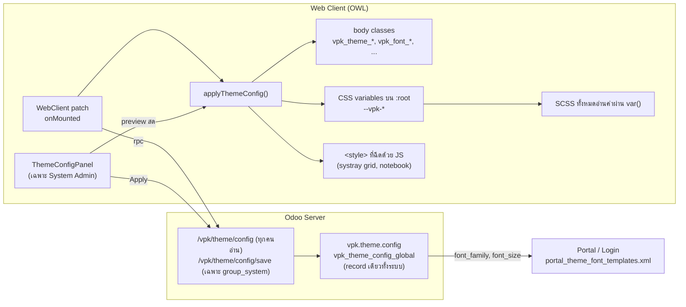

# Design Document: VPK Backend Theme (Odoo 18)

| รายการ | รายละเอียด |
|---|---|
| ระบบ | ERP โรงพยาบาลวชิระภูเก็ต (Odoo 18) |
| โมดูลหลัก | `vpk_sidebar_menu` v18.0.1.9.0 (ธีมหลังบ้าน) |
| โมดูลร่วม | `vpk_login_page` v18.0.1.3.4 (หน้า Login / Signup / Reset password) |
| แนวทางออกแบบ | Modern SaaS (แนว Linear / Stripe / Notion) ตามเอกสาร `modern_erp_ai_guidelines.md`: โทน slate สะอาดตา สีหลักน้ำเงิน ข้อมูลหนาแน่นแต่อ่านง่าย เงาบาง |
| เอกสารนี้อ้างอิงจาก | ซอร์สโค้ดใน `odoo18-custom-addons/` ณ วันที่ 17 พ.ย. 2026 |

---

## 1. วัตถุประสงค์และขอบเขต

ธีมนี้เปลี่ยนหน้าตา Odoo 18 หลังบ้านจากเมนูแนวนอนด้านบนเป็น **Sidebar แนวตั้งด้านซ้าย** พร้อมระบบตั้งค่าธีม (สี ฟอนต์ ขนาด ตำแหน่ง Chatter ฯลฯ) ที่เป็น **ค่ากลางชุดเดียวทั้งระบบ แก้ไขได้เฉพาะ System Administrator** และปรับสไตล์ทั้งระบบเป็นแนว Modern SaaS (ปุ่ม แท็บ ฟิลด์ฟอร์ม ตารางข้อมูล ป้ายสถานะ Dialog)

ขอบเขตที่ครอบคลุม:

- Navbar / App menu → Sidebar สีขาวพร้อมเมนูย่อยซ้อนหลายชั้น และปุ่มค้นหาเมนู (⌘K / Ctrl K)
- Theme Settings panel (ค่ากลางทั้งระบบ เปิดได้เฉพาะ System Administrator)
- สไตล์ Control panel, Form view, List view, Kanban, Notebook, Chatter, Dialog/Wizard, Dropdown, Systray, ป้ายสถานะ
- ฟอนต์ Inter + Noto Sans Thai (ค่าเริ่มต้น) และ IBM Plex Sans Thai / Anuphan / Kanit / Sarabun / Prompt / Roboto ทั้งหลังบ้านและหน้า Portal
- ไอคอนลายเส้น Lucide ใน sidebar และ systray, RemixIcon แทน FontAwesome บางส่วนในหน้าจออื่น
- หน้า Login แบบเต็มจอสองคอลัมน์ (โมดูล `vpk_login_page`)
- ฟิลด์ HTML แบบ TinyMCE (`tinymce_html` widget) ที่อยู่ในโมดูลเดียวกัน

นอกขอบเขต: รายงาน PDF (QWeb report), หน้า Website สาธารณะ, สีของหน้า Login (ยังเป็นชุดสี teal เดิม)

### 1.1 หลักการออกแบบ (จาก guideline)

| หลักการ | การนำไปใช้ในธีม |
|---|---|
| พื้นที่ทำงานสะอาด | พื้นแอป slate-50 `#f8fafc`, การ์ด/sidebar/ตารางเป็นพื้นขาวมีเส้นขอบ slate-200 `#e2e8f0` |
| สีหลักใช้เท่าที่จำเป็น | น้ำเงิน blue-600 `#2563eb` (hover blue-700 `#1d4ed8`) ใช้กับปุ่มหลัก ลิงก์ เมนูที่ active และ focus ring เท่านั้น |
| ลำดับตัวอักษร | หัวข้อ slate-900 `#0f172a`, ตัวอักษรรอง slate-500/600, หัวตารางตัวเล็ก ตัวพิมพ์ใหญ่ เว้นระยะตัวอักษร |
| ตัวเลขอ่านง่าย | `font-variant-numeric: tabular-nums` ในตาราง ฟิลด์ตัวเลข/วันที่ และ stat button; ตัวเลขชิดขวา |
| เงาบาง | ใช้แค่ shadow-sm กับการ์ด/ปุ่ม; เงากลางกับ dropdown; เงาใหญ่สุดกับ dialog |
| มุมโค้ง | การ์ด 12px (rounded-xl), ปุ่มและช่องกรอก 6px (rounded-md) |
| สถานะเป็นป้ายอ่อน | พื้นสีอ่อน -50 ตัวอักษร -700 ขอบ -200 (เขียว/เหลือง/แดง/น้ำเงิน/เทา) |
| ลดสิ่งรบกวน | ปุ่มรองในแถวตาราง (ลบ, เปิดฟอร์ม) แสดงเมื่อเอาเมาส์ชี้แถวเท่านั้น |

---

## 2. สถาปัตยกรรมโดยรวม



หลักการสำคัญ:

1. **ค่าธีมทุกตัวกลายเป็น CSS custom property** บน `document.documentElement` ผ่านฟังก์ชันเดียว `applyThemeConfig()` (`static/src/js/theme_utils.js`) SCSS ไม่ฮาร์ดโค้ดสีหลัก แต่ใช้ `var(--vpk-*)` ทั้งหมด จึงเปลี่ยนธีมได้ทันทีโดยไม่ต้อง compile asset ใหม่
2. **Scope ทุก rule ด้วย `body.o_web_client.o_vpk_sidebar_menu`** — คลาส `o_vpk_sidebar_menu` ถูกใส่ที่ `<body>` ตอน WebClient mount ถ้าถอนโมดูลหรือ WebClient ยังไม่ mount สไตล์จะไม่มีผล
3. **ลำดับการโหลด CSS มีผลต่อการ override** — ไฟล์ส่วนใหญ่โหลดผ่าน `ir.asset` แบบ `append` ที่ sequence 100–120 เพื่อให้อยู่ท้าย bundle และชนะ CSS ของโมดูลอื่น (เช่น `base_accounting_kit`) ไฟล์ `modern_ui.scss` (seq 120) โหลดท้ายสุด

---

## 3. Data Model

### 3.1 `vpk.theme.config`

ไฟล์: `models/vpk_theme_config.py`

| ฟิลด์ | ชนิด | ค่าเริ่มต้น | ค่าที่เลือกได้ / ข้อจำกัด |
|---|---|---|---|
| `theme_style` | Selection | `rounded` | `rounded`, `standard`, `square` |
| `menu_position` | Selection | `vertical` | `vertical`, `horizontal` |
| `chatter_position` | Selection | `bottom` | `right`, `bottom` |
| `tree_form_split_view` | Boolean | `False` | |
| `list_view_density` | Selection | `comfortable` | `comfortable`, `compact` |
| `list_view_sticky_header` | Boolean | `False` | |
| `sidebar_color` | Char | `#2563eb` | **Primary Color** — สีหลักของระบบ (ปุ่ม ลิงก์ เมนูที่ active focus ring) ชื่อฟิลด์คงไว้เพื่อความเข้ากันได้ |
| `sidebar_active_color` | Char | `#1d4ed8` | **Primary Hover Color** — สีปุ่มหลักตอน hover |
| `sidebar_text_color` | Char | `#ffffff` | **Text on Primary** — ตัวอักษรบนปุ่มหลัก |
| `font_family` | Selection | `inter` | `default`, `inter`, `kanit`, `sarabun`, `prompt`, `roboto` |
| `font_size` | Selection | `medium` | `small`, `medium`, `large` |
| `loader_style` | Selection | `default` | `default`, `dots`, `bars` |
| `sidebar_width` | Integer | `256` | clamp 200–420 px ใน `create`/`write` |
| `sidebar_collapsed_width` | Integer | `80` | clamp 56–120 px |

### 3.2 ค่ากลางชุดเดียว (Global) และสิทธิ์

ทั้งระบบมี record เดียวคือ `vpk_sidebar_menu.vpk_theme_config_global` (สร้างจาก `data/vpk_theme_config_data.xml` แบบ `noupdate`) ผู้ใช้ทุกคนเห็นธีมเดียวกัน และอ่านค่าผ่าน `_get_global_config()`

| กลุ่ม | อ่าน | แก้ไข / สร้าง | ลบ |
|---|---|---|---|
| `base.group_user` (ผู้ใช้ทั่วไป) | ✓ | ✗ | ✗ |
| `base.group_system` (System Administrator) | ✓ | ✓ | ✗ |

สิทธิ์ถูกบังคับ 3 ชั้น: ACL ใน `security/ir.model.access.csv`, การตรวจ `base.group_system` ใน controller ก่อนบันทึก และการซ่อนปุ่มตั้งค่าธีมในหน้าจอสำหรับผู้ที่ไม่ใช่ admin (`user.isSystem`)

### 3.3 การแชร์ฟอนต์ไปหน้า Portal

หน้า Portal / Vendor / Login อ่าน `font_family` และ `font_size` จาก record กลางโดยตรงผ่าน `_get_portal_font_settings()` จึงใช้ฟอนต์เดียวกับหลังบ้านเสมอ

### 3.4 Migration ที่เกี่ยวข้อง

| เวอร์ชัน | สิ่งที่ทำ |
|---|---|
| 18.0.1.7.54 | ปรับ `sidebar_width` 240 → 288 |
| 18.0.1.7.69 | ลดทุกค่า `sidebar_width` ลง 10% |
| 18.0.1.7.70 | แก้ค่าที่ได้จากข้อก่อน (259) กลับเป็น 288 |
| 18.0.1.8.0 | เปลี่ยนจากธีมรายผู้ใช้เป็นธีมกลาง: คัดลอกค่าของผู้ใช้ `base.user_admin` (ถ้าไม่มีใช้ค่าที่บันทึกล่าสุด) ไปที่ record กลาง ลบ config รายผู้ใช้ ลบฟิลด์ `res.users.vpk_theme_config_id` และ System Parameter `vpk.portal.font_*` |
| 18.0.1.9.0 | เปลี่ยนเป็นสไตล์ Modern SaaS: ตั้ง record กลางเป็น `rounded`, สี `#2563eb` / `#1d4ed8` / `#ffffff`, ฟอนต์ `inter` ขนาด `medium`, sidebar 256 / 80 px (ค่าอื่น เช่น ตำแหน่ง chatter และ sticky header คงเดิม) |

---

## 4. API (Controller)

ไฟล์: `controllers/main.py` — ทั้งสอง route เป็น `type='json'`, `auth='user'`

| Route | หน้าที่ | Request | Response |
|---|---|---|---|
| `/vpk/theme/config` | อ่านธีมกลาง (ผู้ใช้ทุกคน) | `{}` | dict ของฟิลด์ทั้งหมดในข้อ 3.1 |
| `/vpk/theme/config/save` | บันทึกธีมกลาง (เฉพาะ System Administrator) | dict บางฟิลด์ (whitelist ตาม `CONFIG_FIELDS`) | dict หลังบันทึก |

ถ้าผู้ใช้ที่ไม่อยู่ใน `base.group_system` เรียก `/vpk/theme/config/save` ระบบจะตอบ `AccessError: Only System Administrators can change the theme.` การบันทึกไม่ใช้ `sudo()` จึงผ่าน ACL ของ Odoo อีกชั้นหนึ่ง

---

## 5. Design Tokens (CSS Custom Properties)

ค่าเริ่มต้นประกาศใน `sidebar_menu.scss` (`:root`) token สีหลัก ขนาด และมุมโค้งถูกเขียนทับตอนรันไทม์โดย `applyThemeConfig()` ส่วน token โทน slate เป็นค่าคงที่

### 5.1 สีหลัก (ปรับได้จาก Theme Settings)

| Token | ที่มา | ใช้กับ |
|---|---|---|
| `--vpk-primary` | `sidebar_color` | ปุ่มหลัก, ลิงก์, เมนูที่ active, แท็บที่ active, focus ring, checkbox, ตัวนับแจ้งเตือน |
| `--vpk-primary-hover` | `sidebar_active_color` | ปุ่มหลัก/ลิงก์ตอน hover |
| `--vpk-on-primary` | `sidebar_text_color` | ตัวอักษรบนปุ่มหลัก |
| `--vpk-primary-soft` | `color-mix(primary 8%, ขาว)` | พื้นเมนูที่ active, แถวที่เลือก, ป้ายสถานะ primary, ขั้น statusbar ปัจจุบัน |
| `--vpk-primary-ring` | `color-mix(primary 25%, โปร่ง)` | วงแหวน focus ของปุ่มค้นหา sidebar และปุ่มหลัก |
| `--o-brand-primary`, `--o-action` | `sidebar_color` | override ตัวแปรของ Odoo core |

### 5.2 สีพื้นผิวและตัวอักษร (คงที่ — slate)

| Token | ค่า | Tailwind เทียบ | ใช้กับ |
|---|---|---|---|
| `--vpk-app-bg` | `#f8fafc` | slate-50 | พื้นหลังแอป รอบการ์ดฟอร์ม/ตาราง/kanban |
| `--vpk-surface` | `#ffffff` | white | sidebar, การ์ด, ตาราง, dialog, control panel |
| `--vpk-surface-muted` | `#f8fafc` | slate-50 | หัวตาราง, แถว hover, footer dialog, ช่องค้นหา |
| `--vpk-hover-bg` | `#f1f5f9` | slate-100 | hover ของเมนู/ปุ่มไอคอน/dropdown item |
| `--vpk-border` | `#e2e8f0` | slate-200 | ขอบการ์ด ช่องกรอก เส้นแบ่งหลัก |
| `--vpk-border-subtle` | `#f1f5f9` | slate-100 | เส้นแบ่งแถวตาราง |
| `--vpk-field-border-hover` | `#cbd5e1` (fallback) | slate-300 | ขอบช่องกรอกตอน hover |
| `--vpk-text` | `#0f172a` | slate-900 | ตัวอักษรหลัก หัวข้อ |
| `--vpk-text-secondary` | `#475569` | slate-600 | label ฟอร์ม เมนู sidebar |
| `--vpk-text-muted` | `#64748b` | slate-500 | หัวตาราง คำทักทาย ไอคอน systray |
| `--vpk-text-faint` | `#94a3b8` | slate-400 | ลูกศรเมนู ไอคอนรอง |

Token ชื่อเดิม (`--vpk-sidebar-bg-start`, `-bg-end`, `-bg-gradient`, `-bg`, `-text`, `--vpk-primary-color`, `--vpk-primary-color-dark`) ยังตั้งค่าอยู่เพื่อให้โมดูลอื่นใช้ได้ แต่ชี้ไปที่สีหลัก (`-bg-gradient` เป็นสีเรียบ ไม่ใช่ gradient แล้ว)

### 5.3 ป้ายสถานะ (Status pills)

| สถานะ | คลาส Odoo | พื้น | ตัวอักษร | ขอบ |
|---|---|---|---|---|
| สำเร็จ | `text-bg-success` | `#ecfdf5` emerald-50 | `#047857` emerald-700 | `#a7f3d0` emerald-200 |
| รอดำเนินการ | `text-bg-warning` | `#fffbeb` amber-50 | `#b45309` amber-700 | `#fde68a` amber-200 |
| ผิดพลาด/ยกเลิก | `text-bg-danger` | `#fff1f2` rose-50 | `#be123c` rose-700 | `#fecdd3` rose-200 |
| ข้อมูล | `text-bg-info` | `#eff6ff` blue-50 | `#1d4ed8` blue-700 | `#bfdbfe` blue-200 |
| หลัก | `text-bg-primary` | `--vpk-primary-soft` | `--vpk-primary` | primary 25% |
| ทั่วไป | `text-bg-secondary` / `light` / `muted` | `#f1f5f9` slate-100 | `#475569` slate-600 | `#e2e8f0` slate-200 |

ทุกป้ายเป็นทรงแคปซูล (`border-radius: 9999px`) ตัวอักษรหนา 500 มีผลเฉพาะในพื้นที่เนื้อหาและ dialog (ไม่กระทบตัวนับแจ้งเตือนใน systray)

### 5.4 Typography

| Token | small | medium (ค่าเริ่มต้น) | large |
|---|---|---|---|
| `--vpk-font-size` (base) | 12px | 13px | 14px |
| `--vpk-font-size-sm` (หัวตาราง, label เล็ก) | 11px | 11px | 12px |
| `--vpk-font-size-md` | 12px | 13px | 14px |
| `--vpk-font-size-lg` (หัว dialog) | 14px | 15px | 16px |
| `--vpk-font-size-xl` (ชื่อเรกคอร์ด) | 18px | 20px | 22px |
| `--vpk-list-header-height` | 2rem | 2.25rem | 2.5rem |
| `--vpk-list-thead-padding-y` | 0.4rem | 0.5rem | 0.6rem |
| `--vpk-field-height` | 30px | 34px | 38px |

`--vpk-font-family` และ `--bs-body-font-family` ถูกตั้งตามที่เลือก ค่าเริ่มต้น `inter` = `'Inter', 'Noto Sans Thai', sans-serif` (Inter ไม่มีอักษรไทย จึงจับคู่กับ Noto Sans Thai ซึ่งออกแบบให้เข้ากัน) ตัวเลือกอื่น: `'IBM Plex Sans Thai' / 'Anuphan' / 'Kanit' / 'Sarabun' / 'Prompt' / 'Roboto', sans-serif` (ฟอนต์ที่ตัวเลขกว้างเท่ากันทุกหลักคือ Inter+Noto Sans Thai, IBM Plex Sans Thai, Anuphan, Sarabun เหมาะกับหน้าที่มีตัวเลขเยอะ ส่วน Kanit / Prompt ตัวเลขไม่ตรงหลัก) ถ้าเลือก `default` จะลบตัวแปรออกและใช้ฟอนต์ Odoo ฟอนต์โหลดจาก Google Fonts แบบ on-demand (`<link id="vpk-google-fonts">`) เฉพาะเมื่อไม่ใช่ `default` ถ้าเครื่องผู้ใช้เข้า Google Fonts ไม่ได้ เบราว์เซอร์จะใช้ฟอนต์ระบบแทน

### 5.5 รูปทรงและเงา

| Token | rounded (ค่าเริ่มต้น) | standard | square |
|---|---|---|---|
| `--vpk-border-radius-lg` (การ์ด, dialog, ตาราง) | 12px | 8px | 0 |
| `--vpk-border-radius-md` (ปุ่ม, ช่องกรอก, เมนู) | 6px | 4px | 0 |
| `--vpk-border-radius-sm` (facet, kbd) | 4px | 3px | 0 |

| Token | ค่า | ใช้กับ |
|---|---|---|
| `--vpk-shadow-sm` | `0 1px 2px 0 rgba(15,23,42,.05)` | การ์ดฟอร์ม statusbar chatter ตาราง ปุ่ม (`--vpk-box-shadow-common` ชี้มาที่ค่านี้) |
| `--vpk-shadow-md` | `0 4px 6px -1px rgba(15,23,42,.08), 0 2px 4px -2px rgba(15,23,42,.05)` | dropdown, เมนูผู้ใช้, sidebar บนมือถือ |
| (dialog) | `0 10px 15px -3px rgba(15,23,42,.1), 0 4px 6px -4px rgba(15,23,42,.1)` | `.modal-content` |

### 5.6 Layout

| Token | ความหมาย |
|---|---|
| `--vpk-sidebar-width` | ความกว้าง sidebar ตอนกาง (ค่าเริ่มต้น 256px = w-64) |
| `--vpk-sidebar-width-collapsed` | ความกว้างตอนพับ (ค่าเริ่มต้น 80px = w-20) |
| `--vpk-main-offset` | ระยะ `padding-left` ของเนื้อหา วัดจากความกว้าง sidebar จริง (0 บนมือถือ/โหมด fullscreen) |
| `--vpk-main-width` | ความกว้างพื้นที่เนื้อหาที่ใช้ได้ |
| `--vpk-viewport-width` | ความกว้าง viewport |
| `--vpk-notebook-min-height` | ความสูงขั้นต่ำของ notebook = max(400px, 38% ของความสูงจอ) และล็อกให้ไม่หดเมื่อสลับแท็บ |

### 5.7 Body classes

`applyThemeConfig()` ใส่คลาสที่ `<body>` เพื่อให้ SCSS แยกสไตล์ตามค่าได้:

`o_vpk_sidebar_menu`, `o_vpk_sidebar_collapsed`, `vpk_theme_{rounded|standard|square}`, `vpk_font_{family}`, `vpk_font_size_{size}`, `vpk_loader_{style}`, `vpk_chatter_{right|bottom}`, `vpk_list_compact`, `vpk_list_sticky_header`, `vpk_tree_split_view`, `vpk_menu_{horizontal|vertical}`

---

## 6. Component Design

### 6.1 Sidebar (แทน NavBar)

ไฟล์: `static/src/js/sidebar_menu.js`, `static/src/xml/sidebar_menu.xml`, `static/src/scss/sidebar_menu.scss`

Patch `web.NavBar` แบบ `replace` ทั้ง `<header class="o_navbar">` แล้ววาง sidebar ทับด้วย `position: fixed` ที่ด้านซ้าย สูงเต็มจอ พื้นขาว เส้นขอบขวา slate-200 ไม่มีเงา เมนูเดิมของ Odoo (`o_main_navbar`) ยังอยู่แต่ถูกซ่อนด้วย `d-none`

โครงสร้างจากบนลงล่าง:

| ส่วน | รายละเอียด |
|---|---|
| โลโก้ | แถบสูง 56px (h-14) มีเส้นใต้ โลโก้บริษัทสูงสุด 40px ตอนพับเหลือไอคอน 32px |
| โปรไฟล์ผู้ใช้ | แถวเดียว: Avatar วงกลม 36px + ชื่อ (13px/600 slate-900) + คำทักทาย (11px slate-500) hover พื้น slate-100 คลิกเปิด User menu (dropdown ขอบ slate-200 เงากลาง หัวข้อตัวเล็กพิมพ์ใหญ่) |
| ปุ่มค้นหา (⌘K) | กล่องสูง 34px พื้น slate-50 ขอบ slate-200 มีไอคอนค้นหา ข้อความ "Search…" และป้าย `⌘K` (Mac) / `Ctrl K` (อื่นๆ) คลิกแล้วเปิด Command Palette ของ Odoo ในโหมดค้นหาเมนู (`/`) ตอนพับเหลือปุ่มไอคอน 40px |
| Systray | ไอคอน 30×30px grid 7 คอลัมน์ ช่องว่าง 2px สี slate-500 hover พื้น slate-100 มีเส้นใต้แยกจากเมนู |
| รายการแอป | ไอคอนแอป 20px + ชื่อ, padding `7px 10px`, มุม `radius-md`, ตัวอักษร slate-600; hover พื้น slate-100 ตัวอักษร slate-900; แอปที่ active พื้น `--vpk-primary-soft` ตัวอักษร `--vpk-primary` หนา 500 |
| เมนูย่อย | ซ้อนได้ไม่จำกัดชั้น (template `vpk_sidebar_menu.SubMenuItem` เรียกตัวเองซ้ำ) มีเส้นนำสายตาแนวตั้ง slate-200 ด้านซ้าย เมนูที่มีลูกหนา 500 ตัวอักษร slate-600, เมนูปลายทาง slate-500 |
| ปุ่มพับ | แถบล่างสุดสูง 40px เส้นบน slate-200 ไอคอน slate-500 hover พื้น slate-100 |

พฤติกรรม:

- คลิกแอปที่มีเมนูย่อย: กาง/หุบ และเปิด action แรกของแอป เมื่อกางแอปใหม่ แอปอื่นจะหุบ (accordion)
- แอปปัจจุบันถูกกางอัตโนมัติเมื่อเปลี่ยนหน้า
- โหมดพับ: ซ่อนชื่อแอป ข้อมูลผู้ใช้ systray เมนูย่อย และข้อความในปุ่มค้นหา เหลือแต่ไอคอน
- จอ ≤ 767.98px: sidebar ซ่อนนอกจอ (`translateX(-100%)`) มีปุ่ม hamburger มุมซ้ายบน (พื้นขาว ขอบ slate-200) เปิดแล้วมี backdrop slate-900 โปร่ง 30% คลิกเพื่อปิด
- สถานะพับ/กาง **ไม่ถูกบันทึก** — รีเฟรชหน้าแล้วจะกลับเป็นกาง

### 6.2 Systray

ไฟล์: `static/src/xml/sidebar_menu.xml`, `systray_inherit.xml`, `scss/systray_spiffy.scss`

ย้าย systray จาก navbar มาไว้ใต้ปุ่มค้นหา แบ่งเป็นสองกลุ่ม (แสดงต่อกันใน grid เดียว):

- **Primary** (ปุ่มที่ธีมสร้างเอง): สลับบริษัท (ไอคอน `vpk-li-building-2`), Debug (แสดงเฉพาะโหมด debug), Theme Setting, Sidebar Size, Pin sidebar, Notes (เปิด Discuss), Tips — ปุ่ม Theme Setting, Sidebar Size และ Tips แสดงเฉพาะ System Administrator
- **Secondary** (ดึงจาก systray registry ตามลำดับคงที่): Debug menu, Messaging, Tier Validation reviewer, My Profile (เปิด `base.action_res_users_my`), Activity

ตัวนับแจ้งเตือนเป็นแคปซูลสี `--vpk-primary` ตัวอักษรขาว มีขอบขาว 2px ตัดกับไอคอน; dropdown ของ systray ขอบ slate-200 เงากลาง

ซ่อน `web.user_menu` และ `burger_menu` เพราะย้ายไปอยู่ที่โปรไฟล์แล้ว ถ้าไม่ได้อยู่โหมด debug จะเว้นช่องว่างไว้แทนปุ่ม Debug เพื่อให้ grid ไม่เลื่อน

### 6.3 Theme Settings Panel

ไฟล์: `static/src/js/theme_config_panel.js`, `xml/theme_config_panel.xml`, `scss/theme_config_panel.scss`

เปิดได้เฉพาะ System Administrator ค่าที่ Apply มีผลกับผู้ใช้ทุกคน (ใต้หัวข้อ panel มีข้อความ "Applies to all users") ผู้ใช้อื่นจะเห็นค่าใหม่เมื่อโหลดหน้าใหม่

Drawer เลื่อนเข้าจากขวา กว้าง 95vw สูงสุด 920px มีเส้นขอบซ้าย slate-200 และ overlay slate-900 โปร่ง 30% แบ่งเป็นแท็บซ้าย 220px + เนื้อหาขวา สีเน้นในแผงใช้ `--vpk-primary`

| แท็บ | ตัวเลือก |
|---|---|
| General Settings | Theme Style, Badge Style (Pill / Rounded / Square), Menu Position, Chatter Position, Tree Form Split View, List View Density, Sticky Header |
| Colors | Primary Color (ปุ่ม ลิงก์ เมนูที่ active), Primary Hover Color, Text on Primary (color picker + ช่องพิมพ์ HEX), Sidebar Background: Light (ขาว) หรือ Gradient ไล่สีบนลงล่าง เลือกสี Top / Bottom ได้ (ค่าเริ่มต้น #15803d → #14532d) โหมด Gradient เปลี่ยนตัวอักษร ไอคอน และเส้นใน sidebar เป็นสีขาว |
| Sidebar Size | Preset ความกว้าง Compact 224 / Default 256 / Wide 300 / Extra Wide 360 + slider 200–420 (step 4); Preset ตอนพับ Narrow 64 / Default 80 / Wide 96 + slider 56–120 |
| Font Family | Default, Inter, IBM Plex Sans Thai, Anuphan, Kanit, Sarabun, Prompt, Roboto |
| Font Size | Small, Medium, Large |
| Loaders | Default, Dots, Bars |

Flow:

1. เปิด panel → `onWillStart` โหลดค่าจาก server เก็บเป็น `saved` และ `draft`
2. ทุกการเปลี่ยนค่า → อัปเดต `draft` และเรียก `applyThemeConfig(draft)` ทันที (live preview)
3. **Apply** (ปุ่มหลักสีน้ำเงิน) → POST `/vpk/theme/config/save` แล้วใช้ค่าที่ server ตอบกลับ (หลัง clamp)
4. **Discard** (ปุ่มรองพื้นขาว) หรือคลิก overlay/ปุ่มปิด → ถ้ากด Discard จะคืนค่า `saved`; ถ้าปิดด้วย overlay/ปุ่ม × **ค่า preview ยังค้างอยู่บนหน้าจอจนกว่าจะรีเฟรช** (ดูหัวข้อ 10)
5. **Defaults** → ตั้ง `draft` เป็นค่าเริ่มต้นทั้งหมด (ยังต้องกด Apply)

ถ้าต้องการกลับไปใช้สีเขียวของโรงพยาบาล ให้ System Administrator ตั้ง Primary Color = `#00a884` และ Primary Hover Color = `#047857` ที่แท็บ Colors แล้วกด Apply

### 6.4 ปุ่ม ลิงก์ และ focus

ไฟล์: `scss/button_theme.scss`

| ประเภท | สไตล์ |
|---|---|
| ปุ่มหลัก (`.btn-primary`, `.btn-fill-primary`, statusbar, Send ใน chatter, modal footer) | พื้นสีเรียบ `--vpk-primary` ตัวอักษร `--vpk-on-primary` หนา 500 มุม `radius-md` เงา shadow-sm; hover เป็น `--vpk-primary-hover`; focus-visible มีวงแหวน 2px; disabled โปร่ง 50% |
| ปุ่มรอง (`.btn-secondary`, `.btn-light`, `.btn-outline-secondary` ในเนื้อหาและ dialog) | พื้นขาว ขอบ slate-200 ตัวอักษร slate-600 เงา shadow-sm; hover พื้น slate-50 ขอบ slate-300 ตัวอักษร slate-900 |
| `.btn-outline-primary` | พื้นขาว ขอบและตัวอักษรสีหลัก; hover พื้น `--vpk-primary-soft` |
| ลิงก์ / `.btn-link` / `.text-primary` | `--vpk-primary` hover `--vpk-primary-hover` |
| focus ของช่องกรอก / checkbox / select | ขอบ `--vpk-primary` + วงแหวน 1px (`box-shadow: 0 0 0 1px`) |
| Statusbar (Draft / Approved / Done) | ขั้นปกติตัวอักษร slate-500; ขั้นปัจจุบันพื้น `--vpk-primary-soft` ตัวอักษร `--vpk-primary` หนา 600 |

### 6.5 Form view

ไฟล์: `scss/form_view_theme.scss`, `scss/form_fields.scss`, `scss/text_field_theme.scss`, `js/form_dropdown_patch.js`, `js/text_field_patch.js`

| องค์ประกอบ | สไตล์ |
|---|---|
| พื้นหลังฟอร์ม | `--vpk-app-bg` (slate-50) |
| Sheet | การ์ดขาว ขอบ slate-200 มุม `radius-lg` (12px) เงา shadow-sm เต็มความกว้าง; จอ ≥ lg มี margin บนล่าง 12px |
| Statusbar | การ์ดขาว ขอบ slate-200 มุม `radius-lg` padding ซ้ายขวา 10px |
| ชื่อเรกคอร์ด (`.oe_title h1`) | `--vpk-font-size-xl` หนา 600 slate-900 ระยะตัวอักษร -0.01em |
| Label ฟิลด์ | slate-600 หนา 500; ฟิลด์บังคับเป็น slate-900 หนา 600 (ไม่ใช้สีหลักกับ label แล้ว) |
| ฟิลด์ input/select | กรอบ 4 ด้าน slate-200 สูง `--vpk-field-height` มุม `radius-md` พื้นขาว; hover ขอบ slate-300; focus ขอบสีหลัก + วงแหวน 1px; เฉพาะฟอร์มที่อยู่ในโหมดแก้ไข และไม่ใช้กับ boolean, radio, image, tags, statusbar, text |
| Textarea | สูงขั้นต่ำ 80px (ใน list 36px) ยืดแนวตั้งได้ (`resize: vertical`) |
| Separator (`o_horizontal_separator`) | หัวข้อส่วน: ตัวเล็ก (`--vpk-font-size-sm`) หนา 600 ตัวพิมพ์ใหญ่ เว้นระยะ 0.05em สี slate-500 เส้นใต้ slate-200 เต็มความกว้าง |
| Stat buttons | คั่นด้วยเส้นตั้ง slate-200 ไอคอน slate-400 ตัวเลข slate-900 หนา 600 `tabular-nums` hover พื้น slate-50 |
| ลิงก์ "เพิ่มบรรทัด" | สีหลัก หนา 500 |
| Dropdown ของ Many2one / Autocomplete | ความกว้างเท่ากรอบฟิลด์ (`form_dropdown_patch.js`); รายการที่เลือกพื้น `--vpk-primary-soft` ตัวอักษรสีหลัก |
| ฟอร์มการชำระเงิน / `.o_vpk_fullwidth_form` | บังคับ sheet เต็มความกว้าง |

### 6.6 Notebook (แท็บในฟอร์ม)

ไฟล์: `scss/form_notebook_theme.scss`, `scss/button_theme.scss`, `js/form_layout_patch.js`, `js/theme_utils.js` (`applyVpkNotebookLayout`, `lockNotebookMinHeight`)

เป้าหมาย: ทุกแท็บมีกล่องขนาดเดียวกัน ("stage") หน้าจอไม่กระตุกเมื่อสลับแท็บ

- Notebook เต็มความกว้าง sheet, หัวแท็บ padding เท่ากับ sheet
- เนื้อหาแท็บสูงขั้นต่ำ `--vpk-notebook-min-height` และล็อกที่ความสูงมากสุดที่เคยแสดง
- กลุ่มที่มีคอลัมน์เดียว (Odoo ปกติให้ 50%) ขยายเป็น 100%
- x2many list ภายในแท็บไม่มี margin ติดลบ
- แท็บแบบเส้นใต้ (underline): แถบหัวมีเส้นล่าง slate-200; แท็บปกติตัวอักษร slate-500 หนา 500 พื้นโปร่ง ไม่มีกรอบ; hover ตัวอักษร slate-900; active ตัวอักษรสีหลัก หนา 600 เส้นใต้สีหลัก 2px; บนจอ ≤ md แท็บเลื่อนแนวนอนได้ ไม่ตัดบรรทัด
- แท็บนอกฟอร์ม (หน้า Settings ฯลฯ) ใช้แบบเส้นใต้เหมือนกัน

### 6.7 Chatter

ไฟล์: `scss/form_chatter.scss`, `js/form_layout_patch.js` (patch `FormRenderer.mailLayout`)

| ค่า `chatter_position` | ผลลัพธ์ |
|---|---|
| `bottom` (ค่าเริ่มต้น) | บังคับ chatter อยู่ใต้ฟอร์มทุกขนาดจอ |
| `right` | chatter อยู่ขวา กว้าง 34% เมื่อพื้นที่เนื้อหา ≥ 900px; ถ้าแคบกว่านั้นจะย้ายลงล่างอัตโนมัติ |

Chatter แสดงเป็นการ์ดขาว ขอบ slate-200 มุม `radius-lg` เงา shadow-sm บนพื้น slate-50 ใช้ฟอนต์ธีม (รองรับ emoji ด้วย `"text-emoji"` นำหน้า)

### 6.8 Control panel

ไฟล์: `scss/modern_ui.scss`

| องค์ประกอบ | สไตล์ |
|---|---|
| แถบ control panel | พื้นขาว เส้นล่าง slate-200 ไม่มีเงา |
| Breadcrumb | ระดับก่อนหน้า slate-500 (hover slate-900) ระดับปัจจุบัน slate-900 หนา 600 ตัวคั่น slate-400 |
| ช่องค้นหา (`.o_searchview`) | พื้น slate-50 ขอบ slate-200 มุม `radius-md`; hover ขอบ slate-300; focus พื้นขาว ขอบสีหลัก + วงแหวน 1px; facet พื้นขาวขอบ slate-200 หัว facet พื้น `--vpk-primary-soft` |
| ปุ่มสลับมุมมอง | ปกติ slate-500; มุมมองปัจจุบันพื้น `--vpk-primary-soft` ตัวอักษรสีหลัก |
| Pager | slate-500 ตัวเลข `tabular-nums` |

### 6.9 List view (ตารางข้อมูล)

ไฟล์: `scss/list_view_theme.scss`, `scss/modern_ui.scss`, `scss/theme_config_panel.scss`

| องค์ประกอบ | สไตล์ |
|---|---|
| กรอบตาราง (หน้า list หลัก) | วางบนพื้น slate-50 ห่างขอบ 16px ตัวตารางเป็นการ์ดขาว ขอบ slate-200 มุม `radius-lg` เงา shadow-sm (one2many ในฟอร์มไม่มีกรอบการ์ด) |
| หัวตาราง | สูงคงที่ `--vpk-list-header-height` ตัวอักษรกึ่งกลางแนวตั้ง ขนาด `--vpk-font-size-sm` หนา 500 slate-500 ตัวพิมพ์ใหญ่ เว้นระยะ 0.05em พื้น slate-50 เส้นล่าง slate-200 (`text-xs font-medium text-slate-500 uppercase tracking-wider`) |
| แถว | ไม่มีสีสลับแถว เส้นแบ่งแถว slate-100 (`divide-y divide-slate-100`); hover พื้น slate-50; แถวที่เลือกพื้น `--vpk-primary-soft` |
| ตัวเลข | ชิดขวา และทั้งตารางใช้ `tabular-nums` ตัวเลขจึงตรงหลักกัน |
| แถวกลุ่ม / แถวรวม (tfoot) | พื้น slate-50 หนา 600 เส้นบน slate-200 |
| ปุ่มรองในแถว | ปุ่มลบแถว (ไอคอนถังขยะ RemixIcon สี slate-400 hover rose-700) และปุ่มเปิดฟอร์ม แสดงเฉพาะเมื่อชี้แถวหรือแถวมี focus (เฉพาะอุปกรณ์ที่มีเมาส์ `@media (hover: hover)`; จอสัมผัสแสดงตลอด) |
| `vpk_list_compact` | padding แถวบนล่าง 2px |
| `vpk_list_sticky_header` | หัวตารางติดด้านบนเมื่อเลื่อน |

### 6.10 Kanban

ไฟล์: `scss/modern_ui.scss`

พื้นหลัง slate-50; การ์ดพื้นขาว ขอบ slate-200 มุม `radius-lg` ไม่มีเงา hover ขอบ slate-300 + shadow-sm; หัวคอลัมน์ slate-900 หนา 600

### 6.11 Dialog / Wizard / Dropdown / Command Palette

ไฟล์: `scss/dialog_theme.scss`, `scss/modern_ui.scss`, `xml/dialog_inherit.xml`, `js/layout_utils.js` (`bindVpkWizardResize`)

- Dialog: กรอบ slate-200 มุม `radius-lg` เงาใหญ่ (ข้อ 5.5); หัว dialog พื้นขาว เส้นล่าง slate-200 ฟอนต์ธีม ขนาด `--vpk-font-size-lg` หนา 600 slate-900; footer พื้น slate-50 เส้นบน slate-200; backdrop slate-900 โปร่ง 30%
- ความสูงสูงสุด 90vh เนื้อหาเลื่อนในตัว ขนาดขั้นต่ำ 360×200px
- **ลากมุมขวาล่างเพื่อปรับขนาดได้** (มีสัญลักษณ์มุมสี slate-400 โปร่ง 55%) ขยายได้ถึง 95vw
- Dialog "Search More…" (`SelectCreateDialog`) เปิดขนาด `xl` เสมอ
- Dropdown ทั่วไป: ขอบ slate-200 มุม `radius-md` เงากลาง; item hover พื้น slate-100; item ที่เลือกพื้น `--vpk-primary-soft` ตัวอักษรสีหลัก; หัวกลุ่มตัวเล็กพิมพ์ใหญ่ slate-500
- Command Palette (⌘K): ช่องค้นหาไม่มีวงแหวน focus เส้นล่าง slate-200; รายการปกติ slate-600 ส่วนที่ตรงคำค้นเป็นสีหลักตัวหนา; รายการที่เลือกพื้น `--vpk-primary-soft`

### 6.12 Layout และ Responsive

ไฟล์: `scss/layout_responsive.scss`, `js/layout_utils.js`

- เนื้อหาหลัก (`.o_action_manager`) เว้นซ้ายเท่ากับ `--vpk-main-offset` ซึ่ง JS วัดจากความกว้าง sidebar จริงทุกครั้งที่ resize / พับ / เปลี่ยนขนาด
- ห้ามหน้าเลื่อนแนวนอนทั้งหน้า (`overflow-x: hidden/clip`); ตารางกว้างเลื่อนแนวนอนภายในตัวเอง
- ลด `min-width` ของฟอร์ม XXL (Odoo ตั้งไว้ 990px + chatter 530px) ให้หดได้
- Breakpoint ที่ใช้: 767.98px (มือถือ), 992px (side chatter), และ mixin `media-breakpoint-*` ของ Bootstrap

### 6.13 ไอคอน

ไฟล์: `scss/line_icons.scss`, `js/line_icons.js`, `scss/remixicon.scss`, `scss/font_icons.scss`, `static/lib/RemixIcon/remixicon.woff2`

- **ไอคอนลายเส้น Lucide** (ตามแนวทาง `modern_erp_ai_guidelines.md`) ใช้กับ sidebar ทั้งหมด: ไอคอนแอป ปุ่มค้นหา ลูกศรเมนู ปุ่มพับ และแถว systray เส้นหนา 1.75 สีตาม `currentColor` (เทา slate เมื่อปกติ สี primary เมื่อ active)
- `scss/line_icons.scss` สร้างจาก `scripts/build_vpk_line_icons.py` ฝัง SVG เป็น data URI (ไม่โหลดจากอินเทอร์เน็ต) ใช้ `<span class="vpk-li vpk-li-NAME"/>` หรือ `mask-image: var(--vpk-li-NAME)` เพิ่มไอคอนใหม่ให้ใส่ชื่อในสคริปต์แล้วรันใหม่
- ไอคอนแอปกำหนดตาม xmlid ของเมนูหลักใน `APP_LINE_ICONS` (`js/line_icons.js`) แอปที่ไม่มีในรายการใช้ `app-window` แทนรูปไอคอนสีของ Odoo
- ไอคอน FontAwesome ใน systray ที่ Odoo วาดเอง (แชท `fa-comments`, กิจกรรม `fa-clock-o`, อนุมัติ `fa-pencil-square-o`, debug `fa-bug`) ถูกแทนด้วย mask ของ Lucide ใน `systray_spiffy.scss`
- RemixIcon ยังโหลดจากไฟล์ในโมดูลสำหรับไอคอนส่วนอื่น (ประกาศเฉพาะคลาสที่ใช้จริง)
- Mixin `vpk-fa-remix($name, $content)` แทนที่ไอคอน FontAwesome ที่ใช้บ่อย (bars, search, filter, plus, pencil, times, check, cog, print, paperclip ฯลฯ) ด้วยไอคอน Remix แบบเส้นบาง
- มี guard ป้องกันไม่ให้ฟอนต์ธีม (`!important`) ไปทับฟอนต์ไอคอน `.fa`, `.ri`, `.oi`

### 6.14 Typography ข้ามส่วน

ไฟล์: `scss/theme_fonts.scss`, `scss/portal_theme_font.scss`, `views/portal_theme_font_templates.xml`

บังคับฟอนต์ธีมกับส่วนที่ Odoo หรือโมดูลอื่นตั้งฟอนต์ไว้เอง: label ฟอร์ม, แท็บ, separator, chatter, date picker, kanban card, dashboard งบประมาณ (`o_vpk_budget_*`), dashboard รออนุมัติ (`o_vpk_pending_review_*`)

ฝั่ง Portal: template inherit `web.frontend_layout` ฉีด `<style>` และ Google Fonts ตามค่าใน record กลาง และใส่คลาส `vpk_font_*` ที่ `#wrapwrap` (รองรับ `vpk_font_inter`)

### 6.15 TinyMCE HTML Field

ไฟล์: `js/tinymce_html_field.js`, `xml/tinymce_html_field.xml`, `static/lib/tinymce/`

ลงทะเบียน field widget ชื่อ `tinymce_html` (ใช้ `widget="tinymce_html"` ใน view) โหลด TinyMCE แบบ lazy จากไฟล์ในโมดูล มี template เอกสารราชการเริ่มต้น ปัจจุบันยังไม่มี view ในโมดูลอื่นเรียกใช้ widget นี้

---

## 7. หน้า Login (`vpk_login_page`)

หน้า Login ยังไม่ได้ปรับเป็นสไตล์ Modern SaaS และใช้ชุดสี teal/green ของตัวเอง

| ส่วน | รายละเอียด |
|---|---|
| Layout | Grid 2 คอลัมน์ 1.1fr / 0.9fr เต็มจอ; จอ ≤ 991.98px เป็นคอลัมน์เดียว (ภาพสูง 42vh; ≤ 575.98px สูง 32vh) |
| ซ้าย (Hero) | ภาพ `login_hero.jpg` เต็มกรอบ ทับด้วย gradient เขียวเข้ม (โปร่ง 92% → 28% จากบนลงล่าง) หัวข้อ ชื่อหน่วยงาน คำโปรย และเส้นคั่นขาว 3px |
| ขวา (ฟอร์ม) | โลโก้บริษัท, คำอธิบาย, ช่อง Username / Password สูง 3rem **มุมเหลี่ยม (radius 0)**, ปุ่มแสดง/ซ่อนรหัสผ่าน, ลิงก์ "ลืมรหัสผ่าน?" ใต้ช่องรหัส, ปุ่ม "เข้าสู่ระบบ" สีเขียว |
| ฟอนต์ | Prompt (fallback Sarabun) โหลดเฉพาะหน้า login |
| ข้อความ | แก้ได้ผ่าน System Parameter: `vpk_login_page.headline`, `.organisation`, `.tagline`, `.welcome_subtitle`, `.footnote` |
| ผู้ใช้ทดสอบ UAT | ถ้า `vpk_login_page.test_users_enabled = True` จะมี dropdown เลือกบทบาท 21 บทบาท เติม login/password ให้อัตโนมัติ |
| Routing | เข้า `/` แล้ว redirect ไป `/web/login` (ถ้า login แล้วไป `/odoo`) |
| ใช้ร่วมกับ | หน้า Signup และ Reset password ใช้ shell เดียวกัน เปลี่ยนเฉพาะคำอธิบาย |

ชุดสีของหน้า Login (SCSS variables ในไฟล์ `login_page.scss` แยกจากธีมหลังบ้าน):

| ตัวแปร | ค่า | ใช้กับ |
|---|---|---|
| `$vpk-teal-500/600/700` | `#14696e` / `#115f60` / `#0e5250` | พื้น hero, gradient ทับภาพ |
| `$vpk-green-500/600` | `#2f8168` / `#276b57` | ปุ่มเข้าสู่ระบบ / hover |
| `$vpk-ink` | `#16232b` | ตัวอักษรหลัก |
| `$vpk-muted` | `#5f7280` | ตัวอักษรรอง |
| `$vpk-border` | `#cdd8dd` | ขอบช่องกรอก |

---

## 8. Asset Loading

### 8.1 ผ่าน `__manifest__.py` (`web.assets_backend`)

ลำดับ: `remixicon.scss` → `font_icons.scss` → `sidebar_menu.scss` → `form_chatter.scss` → `theme_config_panel.scss` → `list_view_theme.scss` → `dialog_theme.scss` → JS ทั้งหมด → XML templates

`web.assets_frontend`: `portal_theme_font.scss`

### 8.2 ผ่าน `ir.asset` แบบ append (โหลดท้าย bundle)

| Sequence | ไฟล์ |
|---|---|
| 100 | `button_theme.scss` |
| 101 | `layout_responsive.scss` |
| 102 | `list_view_theme.scss` (โหลดซ้ำจาก manifest) |
| 103 | `form_view_theme.scss` |
| 104 | `form_fields.scss` |
| 105 | `theme_fonts.scss` |
| 110 | `form_notebook_theme.scss` |
| 111 | `text_field_theme.scss` |
| 112 | `dialog_theme.scss` (โหลดซ้ำจาก manifest) |
| 113 | `systray_spiffy.scss` |
| 120 | `modern_ui.scss` (control panel, ตาราง, ป้ายสถานะ, kanban, dialog, dropdown, command palette) |

### 8.3 `<style>` ที่ฉีดด้วย JS ตอนรันไทม์

`theme_utils.js` สร้าง `<style>` 2 ชุด (`vpk-systray-theme-styles` สำหรับ grid ของ systray และ `vpk-notebook-theme-styles` สำหรับความสูง notebook ตามขนาดจอ) ชุด `vpk-button-theme-styles` (ปุ่ม gradient) ถูกลบออกตั้งแต่ v18.0.1.9.0 และ `applyThemeConfig()` จะลบ `<style>` เก่านั้นทิ้งถ้ายังค้างอยู่

### 8.4 โมดูลอื่นที่ใช้ token ของธีม

`vpk_budget` (dashboard, ฟอร์มคำของบ), `vpk_tier_validation` (dashboard/kanban รออนุมัติ), `vpk_stock_warehouse` (warehouse overview) อ้างอิง `var(--vpk-sidebar-*)` โดยตรง ตอนนี้ token เหล่านั้นชี้ไปที่สีหลักน้ำเงินแบบสีเรียบ ส่วนที่เคยเป็น gradient จึงเป็นสีเรียบ ถ้าไม่ได้ติดตั้ง `vpk_sidebar_menu` จะ fallback เป็นค่าที่ระบุไว้ใน `var()`

---

## 9. แนวทางสำหรับนักพัฒนา

1. **ใช้ token แทนการฮาร์ดโค้ดสี** — สีหลักใช้ `var(--vpk-primary)`, hover ใช้ `var(--vpk-primary-hover)`, ตัวอักษรบนสีหลักใช้ `var(--vpk-on-primary)`, พื้นเน้นอ่อนใช้ `var(--vpk-primary-soft)`; พื้น/ขอบ/ตัวอักษรใช้ `--vpk-surface`, `--vpk-app-bg`, `--vpk-border`, `--vpk-text*` ใส่ fallback เสมอ เช่น `var(--vpk-primary, #2563eb)` โค้ดใหม่ไม่ควรใช้ `--vpk-sidebar-*` อีก
2. **สีสถานะ** — ใช้ badge ของ Bootstrap (`text-bg-success/warning/danger/info`) แล้วธีมจะแปลงเป็นป้ายอ่อนให้เอง ไม่ต้องตั้งสีเอง
3. **ตัวเลข** — คอลัมน์ตัวเลขให้ชิดขวา ถ้าแสดงตัวเลขนอกตาราง ใส่คลาส `o_vpk_tabular` เพื่อให้ได้ `tabular-nums`
4. **เงาและมุม** — ใช้ `var(--vpk-shadow-sm)` กับการ์ด, `var(--vpk-shadow-md)` กับ popover/dropdown; มุมใช้ `var(--vpk-border-radius-{lg|md|sm})` เพื่อให้ตาม Theme Style ห้ามใช้เงาหนาหรือ gradient
5. **ฟอนต์และขนาด** — ใช้ `var(--vpk-font-family, inherit)` และ `var(--vpk-font-size-md, inherit)`; ถ้าคอมโพเนนต์ตั้ง `font-family` เอง ต้องกันไม่ให้ไปทับ `.fa`, `.ri`, `.oi`
6. **Scope** — ครอบ rule ด้วย `body.o_web_client.o_vpk_sidebar_menu` เพื่อไม่กระทบหน้า Portal/รายงาน
7. **ไฟล์ที่ต้อง override CSS ของโมดูลอื่น** — เพิ่มเป็น `ir.asset` append ใน `data/ir_asset_layout.xml` ด้วย sequence ถัดไป (≥ 121) แทนการเพิ่มใน manifest
8. **เพิ่มตัวเลือกธีมใหม่** ต้องแก้ 5 จุดให้ตรงกัน: ฟิลด์ใน `vpk_theme_config.py` + `_to_dict()`, `CONFIG_FIELDS` ใน controller, `DEFAULT_THEME_CONFIG` และ `applyThemeConfig()` ใน `theme_utils.js`, UI ใน `theme_config_panel.xml`, และ SCSS ที่อ่านค่า
9. **ฟอร์มที่ต้องการเต็มความกว้าง** ให้ใส่ class `o_vpk_fullwidth_form` ที่ `<form>`
10. **ไอคอน Remix ใหม่** ต้องประกาศคลาสและ codepoint ใน `remixicon.scss` ก่อนใช้

---

## 10. ข้อจำกัดและประเด็นที่พบจากโค้ดปัจจุบัน

| # | ประเด็น | รายละเอียด |
|---|---|---|
| 1 | ตัวเลือกที่มีใน UI แต่ยังไม่มีผล | **Loader style**, **Menu Position = Horizontal** และ **Tree Form Split View** บันทึกค่าและใส่ body class ได้ แต่ไม่มี SCSS/JS ใดอ่านคลาส `vpk_loader_*`, `vpk_menu_horizontal`, `vpk_tree_split_view` ผู้ใช้เลือกแล้วหน้าจอไม่เปลี่ยน |
| 2 | สีหน้า Login ไม่ผูกกับธีม | หน้า Login ใช้ชุดสี teal/green ของตัวเอง ไม่ได้อ่านค่าสีจาก `vpk.theme.config` (อ่านแค่ฟอนต์) จึงยังเป็นสีเขียวขณะที่หลังบ้านเป็นน้ำเงิน |
| 3 | ฟอนต์ขึ้นกับ Google Fonts | Inter / Noto Sans Thai และฟอนต์อื่นโหลดจาก `fonts.googleapis.com` ถ้าเครือข่ายโรงพยาบาลบล็อก จะใช้ฟอนต์ระบบแทน |
| 4 | ผู้ใช้ปรับธีมเองไม่ได้ | ตั้งแต่ v18.0.1.8.0 ธีมเป็นค่ากลาง ผู้ใช้ที่ต้องการตัวอักษรใหญ่ขึ้นต้องใช้การซูมของเบราว์เซอร์แทน |
| 5 | Preview ค้างเมื่อปิด panel | ปิด panel ด้วยปุ่ม × หรือคลิก overlay ไม่ได้คืนค่าที่บันทึกไว้ ค่าที่ลองไว้ยังแสดงอยู่จนรีเฟรช (มีเฉพาะปุ่ม Discard ที่คืนค่า) |
| 6 | CSS ซ้ำซ้อน | grid ของ systray และ layout ของ notebook มีทั้งใน SCSS และใน `<style>` ที่ JS ฉีด และ `list_view_theme.scss` / `dialog_theme.scss` ถูกโหลดสองครั้ง |
| 7 | ใช้ `!important` จำนวนมาก | เกิดจากการต้องชนะ CSS ของ Odoo และโมดูลอื่น ทำให้ override ต่อจากโมดูลอื่นยาก ต้องใช้ selector ที่เฉพาะเจาะจงกว่า (เช่น `html body.o_web_client.o_vpk_sidebar_menu …`) |
| 8 | สถานะพับ sidebar ไม่ถูกจำ | รีเฟรชแล้ว sidebar กลับมากางเสมอ |
| 9 | ไม่ตรวจสอบค่าสี | ช่องพิมพ์ HEX รับข้อความอะไรก็ได้ และบันทึกลงฐานข้อมูลโดยไม่ validate |
| 10 | ข้อความ UI ภาษาอังกฤษ | "Search…", "Good Morning/Evening", ป้ายในแผง Theme Settings ยังเป็นภาษาอังกฤษ ไม่มีไฟล์แปล |

ประเด็นที่แก้แล้วใน v18.0.1.9.0: สีเขียว `rgba(0,168,132,…)` ที่ฮาร์ดโค้ดใน focus ring/statusbar (เปลี่ยนเป็น token), event listener `resize` ที่สะสมทุกครั้งที่เรียก `applyThemeConfig()` (ผูกครั้งเดียว), `<style>` ปุ่ม gradient ที่ซ้ำกับ SCSS (ลบแล้ว), systray ยังแสดงตอนพับ sidebar (แก้ specificity)

---

## 11. รายการไฟล์

```
vpk_sidebar_menu/
├── __manifest__.py
├── controllers/main.py               # /vpk/theme/config, /vpk/theme/config/save
├── data/vpk_theme_config_data.xml    # record ธีมกลาง vpk_theme_config_global
├── data/ir_asset.xml                 # button_theme (seq 100)
├── data/ir_asset_layout.xml          # ไฟล์ SCSS ที่โหลดท้าย (seq 101–120)
├── migrations/18.0.1.7.{54,69,70}/   # ปรับค่า sidebar_width
├── migrations/18.0.1.8.0/            # รวมธีมรายผู้ใช้เป็นธีมกลาง
├── migrations/18.0.1.9.0/            # ตั้งค่าธีมกลางเป็นสไตล์ Modern SaaS
├── models/vpk_theme_config.py        # model, _get_global_config, ค่า portal font
├── views/portal_theme_font_templates.xml
└── static/
    ├── lib/RemixIcon/remixicon.woff2
    ├── lib/tinymce/
    └── src/
        ├── js/
        │   ├── sidebar_menu.js           # patch NavBar + WebClient, ปุ่ม ⌘K
        │   ├── theme_config_panel.js     # Theme Settings drawer
        │   ├── theme_utils.js            # applyThemeConfig, tokens, notebook layout
        │   ├── layout_utils.js           # วัด sidebar, main offset, ลากขยาย wizard
        │   ├── form_layout_patch.js      # mailLayout (chatter), notebook height
        │   ├── form_dropdown_patch.js    # ความกว้าง autocomplete dropdown
        │   ├── text_field_patch.js       # textarea ยืดได้
        │   ├── push_notification_patch.js
        │   └── tinymce_html_field.js     # widget tinymce_html
        ├── scss/
        │   ├── sidebar_menu.scss         # design tokens (:root) + sidebar
        │   ├── button_theme.scss         # ปุ่ม ลิงก์ แท็บ focus
        │   ├── form_view_theme.scss      # การ์ดฟอร์ม label separator stat button
        │   ├── form_fields.scss          # กรอบช่องกรอก hover/focus
        │   ├── systray_spiffy.scss       # systray grid ตัวนับแจ้งเตือน
        │   ├── modern_ui.scss            # control panel ตาราง ป้ายสถานะ kanban dialog dropdown
        │   └── …                         # ดูหัวข้อ 6 และ 8
        └── xml/
            ├── sidebar_menu.xml
            ├── theme_config_panel.xml
            ├── systray_inherit.xml
            ├── dialog_inherit.xml
            └── tinymce_html_field.xml

vpk_login_page/
├── controllers/main.py               # / → /web/login
├── models/res_users.py               # รายชื่อผู้ใช้ทดสอบ UAT
├── views/login_templates.xml         # layout 2 คอลัมน์, ฟอร์ม, ฟอนต์ Prompt
└── static/src/
    ├── img/login_hero.jpg
    ├── js/login_page.js              # show/hide password, ย้ายลิงก์ลืมรหัส, UAT picker
    └── scss/login_page.scss
```
