# Workflow / Dataflow ระบบ VPK ERP (Odoo 18): งบประมาณ และจัดซื้อจัดจ้าง

เอกสารนี้สร้างอัตโนมัติด้วย `docs/build_dataflow_md.py` จากข้อมูลชุดเดียวกับ
`Workflow-Dataflow-งบประมาณ.pptx`, `Workflow-Dataflow-จัดซื้อจัดจ้าง.pptx` และ `สรุป-Function-ตาม-Module.xlsx`
(แก้ข้อมูลที่ `budget_dataflow_data.py` / `procurement_dataflow_data.py` แล้วรันสคริปต์ใหม่)

แผนภาพเป็น Mermaid (ดูได้ใน Cursor / GitHub ที่เปิด Markdown preview)

## 1. ภาพรวม: แยกเป็น 2 ชุด

- **ชุดงบประมาณ** สิ้นสุดที่ "แผนงบที่อนุมัติ และพร้อมใช้งาน" (`budget.lines`)
- **ชุดจัดซื้อจัดจ้าง** มี INPUT คือแผนงบที่อนุมัติ นำไปทำใบขอซื้อ (PR) ตามวิธีจัดซื้อ

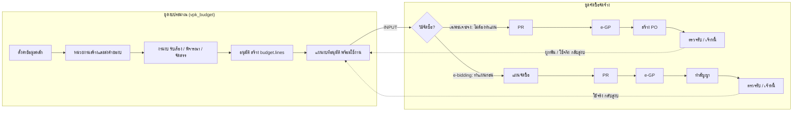

## 2. ชุดงบประมาณ

### 2.1 Workflow

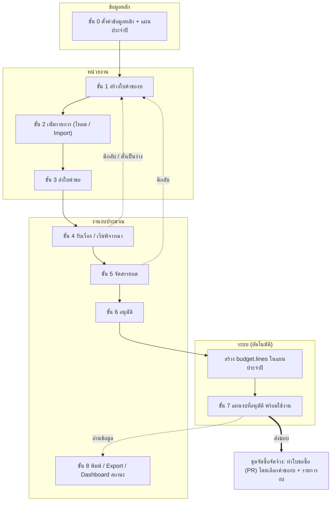

### 2.2 สถานะใบคำของบ (`departmental.budget.request`)

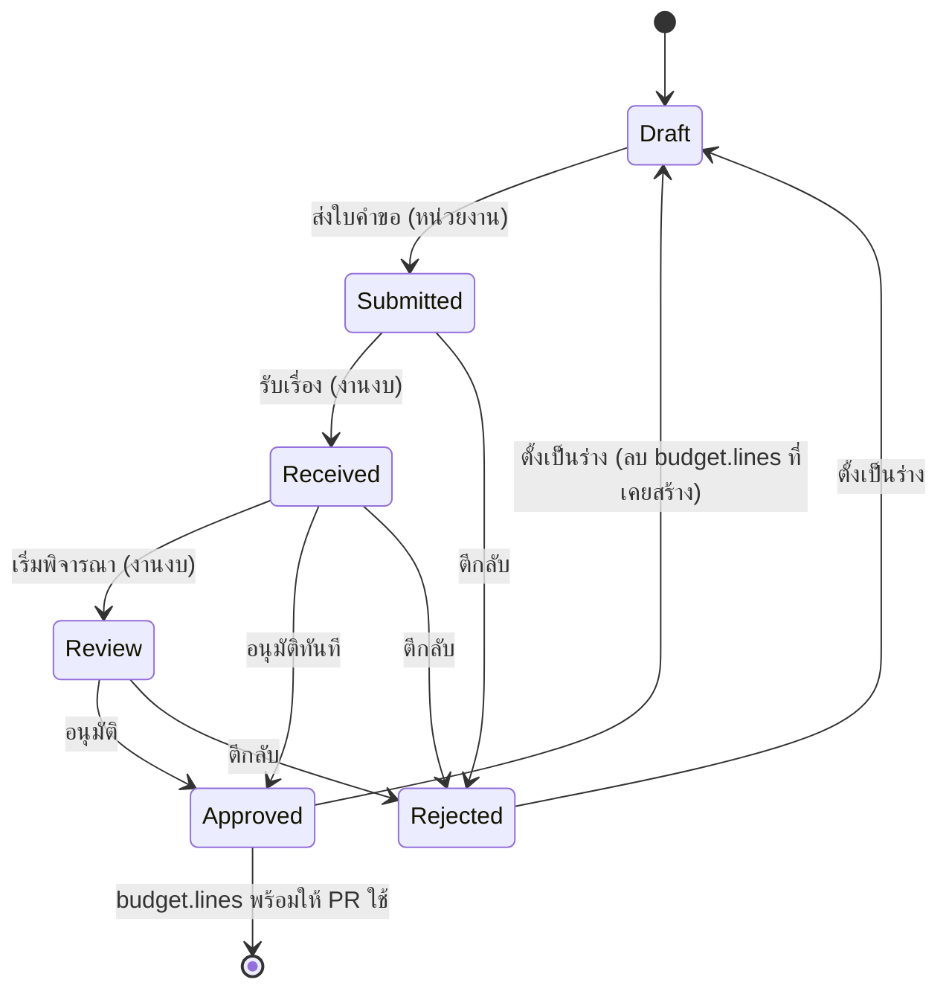

เมื่ออนุมัติ: สร้าง `budget.lines` (planned = ยอดจัดสรร) และกำหนด `budget_record_id` = แผนประจำปี

### 2.3 Data Flow (ระดับ 1)

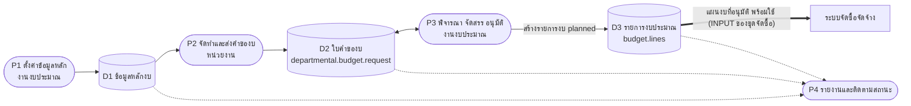

### 2.4 Input / Process / Output ของแต่ละ function

#### A. ตั้งค่าข้อมูลหลักงบประมาณ

_งานงบประมาณเตรียมข้อมูลหลักก่อนเปิดรับคำของบ_

| รหัส | ฟังก์ชัน | ผู้ใช้ | Input | Process | Output | เมนู | Model / Method |
|---|---|---|---|---|---|---|---|
| A1 | **ข้อมูลหลักงบประมาณ** | งานงบประมาณ | • รหัส / ชื่อ / ลำดับ / คำอธิบาย • แหล่งเงิน, ประเภทงบประมาณ • กลุ่มงบ-วัสดุ, ประเภทวัสดุย่อย • กลุ่ม/ประเภทครุภัณฑ์, แบบฟอร์มคำของบ | › สร้าง/แก้ไขข้อมูลหลัก › กำหนดแบบฟอร์ม 4 ประเภท › (วัสดุ ครุภัณฑ์ ก่อสร้าง โครงการ) | • ข้อมูลหลักให้เลือกในใบคำของบ • โครงสร้างบรรทัดของแต่ละแบบฟอร์ม | งบประมาณ > การกำหนดค่า | `vpk.budget.fund.source / .type / .group / .material.sub.type / .asset.category / .request.form.type` |
| A2 | **หมวดงบประมาณ (Budgetary Position)** | งานงบประมาณ / บัญชี | • ชื่อหมวดงบประมาณ • บัญชี GL ที่ผูกกับหมวด (account_ids) | › ผูกหมวดงบกับบัญชีแยกประเภท › เพื่อดึงยอดใช้จริงจาก analytic line | • หมวดงบที่ใช้เลือกในบรรทัดคำของบ/PR • เงื่อนไขคำนวณยอดใช้จริง (practical) | งบประมาณ > การกำหนดค่า > หมวดงบประมาณ | `account.budget.post` |
| A3 | **บัญชีวิเคราะห์ (หน่วยงาน / ศูนย์ต้นทุน)** | งานงบประมาณ / บัญชี | • ชื่อหน่วยงาน / ศูนย์ต้นทุน • บริษัท (องค์กร) | › สร้าง Analytic Account › ใช้เป็นตัวแบ่งงบตามหน่วยงาน | • หน่วยงานที่เลือกได้ในใบคำของบและ PR • แกนแยกงบ/ยอดใช้จริงตามหน่วยงาน | งบประมาณ > การกำหนดค่า > บัญชีวิเคราะห์ | `account.analytic.account` |
| A4 | **งบประมาณประจำปี (แผนงบประมาณ)** | งานงบประมาณ | • ชื่อแผนงบประมาณ / ปีงบประมาณ • วันที่เริ่ม - สิ้นสุดของแผน • บริษัท | › สร้างแผนงบประมาณรายปี › เป็นภาชนะรับรายการงบ (budget lines) | • แผนงบประมาณประจำปี (budget.budget) • ตัวเลือกในช่อง 'ชื่อแผนงบประมาณประจำปี' ของใบคำของบ | งบประมาณ > การกำหนดค่า > งบประมาณประจำปี | `budget.budget` |
| A5 | **Import Budget Master** | งานงบประมาณ / IT | • ไฟล์ Excel หลายชีต (Template) • FundSource, BudgetGroup, ฯลฯ • คีย์จับคู่ = code | › อ่านไฟล์ จับคู่ด้วย code › สร้างใหม่/อัปเดตข้อมูลหลัก › ตรวจรูปแบบข้อมูล | • ข้อมูลหลักถูกสร้าง/อัปเดตทั้งชุด • ผลการนำเข้า / ข้อผิดพลาดรายแถว | งบประมาณ > การกำหนดค่า > Import Budget Master | `vpk.budget.master.import.wizard` |

#### B. หน่วยงาน: จัดทำและส่งคำของบ

_หน่วยงานสร้างใบคำของบ ใส่รายการ และส่งให้งานงบประมาณ_

| รหัส | ฟังก์ชัน | ผู้ใช้ | Input | Process | Output | เมนู | Model / Method |
|---|---|---|---|---|---|---|---|
| B1 | **สร้างใบคำของบ** | หน่วยงาน | • ปีงบประมาณ, ในแผน/นอกแผน • หน่วยงาน, แหล่งเงิน • แผนงบประมาณประจำปี • แบบฟอร์มคำของบ (วัสดุ/ครุภัณฑ์/ก่อสร้าง/โครงการ) | › สร้างเอกสาร สถานะ Draft › กำหนดผู้ขอ = ผู้ใช้ปัจจุบัน | • ใบคำของบ สถานะ Draft • แท็บรายการตามแบบฟอร์มที่เลือก | งบประมาณ > บันทึกคำของบ | `departmental.budget.request` |
| B2 | **โหลดรายการตามหมวด / กลุ่ม** | หน่วยงาน | • ใบคำของบ (Draft) • หมวดงบ / ประเภทวัสดุ / กลุ่มครุภัณฑ์ ที่เลือก • รายการสินค้าในข้อมูลหลัก | › ดึงสินค้า/ครุภัณฑ์ตามหมวด › ใส่เป็นบรรทัดรายละเอียดอัตโนมัติ | • บรรทัดรายละเอียดสินค้า/ครุภัณฑ์ • รอหน่วยงานกรอกจำนวน/ราคา | ปุ่มโหลดรายการในใบคำของบ | `action_load_material_category_products / action_load_asset_category_products` |
| B3 | **นำเข้ารายการวัสดุจาก Excel** | หน่วยงาน | • ไฟล์ Excel ตาม Template • (รหัส/ชื่อสินค้า, จำนวน, ราคา) | › อ่านแถว จับคู่สินค้าด้วยรหัส/ชื่อ › ตรวจตัวเลข | • บรรทัดรายละเอียดวัสดุ (material detail) • รายงานแถวที่จับคู่ไม่ได้ | ปุ่ม Import ในแท็บรายละเอียดสินค้า | `vpk.budget.material.detail.import.wizard` |
| B4 | **กรอกรายการ / ใช้ข้อมูลย้อนหลัง** | หน่วยงาน | • จำนวน, ราคาต่อหน่วย, เหตุผล • ประวัติคำของบ/ยอดใช้จริงปีก่อน | › คำนวณยอดรวมบรรทัด › ดึงยอดปีก่อนมาอ้างอิง (usage history) | • ยอดงบประมาณที่ขอ (total_amount) • ยอดปีก่อน/ใช้จริงบนบรรทัด | แท็บรายการในใบคำของบ | `action_apply_usage_history / departmental.budget.request.line` |
| B5 | **ส่งใบคำขอ** | หน่วยงาน | • ใบคำของบ Draft • เหตุผลประกอบคำขอ (หรือเหตุผลรายบรรทัด) • รายการ ≥ 1 บรรทัด, รายละเอียดวัสดุครบประเภท | › ตรวจความครบถ้วน › รวมยอดวัสดุจากรายละเอียด › บันทึกวันเวลาส่ง | • สถานะ = Submitted • submission_date • หน่วยงานแก้ไขเนื้อหาไม่ได้อีก | ปุ่ม 'ส่งใบคำขอ' | `action_submit` |

#### C. งานงบประมาณ: พิจารณา จัดสรร อนุมัติ

_รับเรื่อง จัดสรรยอด อนุมัติ และสร้างรายการงบในแผนประจำปี_

| รหัส | ฟังก์ชัน | ผู้ใช้ | Input | Process | Output | เมนู | Model / Method |
|---|---|---|---|---|---|---|---|
| C1 | **รับเรื่อง / เริ่มพิจารณา** | งานงบประมาณ | • ใบคำของบสถานะ Submitted | › เปลี่ยนสถานะตามลำดับ › Received → Under Review | • สถานะ = Received / Review • งานงบประมาณแก้ไขยอดจัดสรรได้ | ปุ่ม 'รับเรื่อง' / 'เริ่มพิจารณา' | `action_receive / action_start_review` |
| C2 | **จัดสรรงบ (Allocate)** | งานงบประมาณ | • ใบคำของบ + หมวดงบ (เว้นว่าง = ทุกรายการ) • วิธีจัดสรร: เท่ากับที่ขอ / เพิ่ม / ลด • เปอร์เซ็นต์ปรับ | › คำนวณยอดจัดสรรต่อบรรทัด › คัดลอกยอดขอ → ยอดจัดสรร | • allocated_budget_amount ต่อบรรทัด • จำนวนจัดสรร (allocated_qty) • งบประมาณที่ได้รับรวม | ปุ่มจัดสรรงบ (Wizard) | `vpk.budget.material.allocation.wizard` |
| C3 | **อนุมัติ → สร้างรายการงบ** | งานงบประมาณ | • ใบคำของบ (Received/Review) • ยอดจัดสรรครบทุกบรรทัด • แผนงบประมาณประจำปี | › ตรวจครบถ้วน › กระจายยอดจัดสรรลงรายละเอียดวัสดุ › สร้าง budget.lines ในแผนประจำปี | • สถานะ = Approved • budget.lines (planned = ยอดจัดสรร) • ระบุ หน่วยงาน/แหล่งเงิน/กลุ่มงบ/ในแผน-นอกแผน | ปุ่ม 'อนุมัติ' | `action_approve / _sync_budget_lines_to_annual_plan` |
| C4 | **ตีกลับ / ตั้งเป็นร่าง** | งานงบประมาณ | • ใบคำของบ (ทุกสถานะที่ไม่ใช่ Draft) • บันทึกการพิจารณา (review note) | › เปลี่ยนสถานะ › ถ้าตั้งเป็นร่าง: ลบ budget.lines ที่เคยสร้าง | • สถานะ = Rejected / Draft • หน่วยงานแก้ไขและส่งใหม่ได้ | ปุ่ม 'ตีกลับ' / 'ตั้งเป็นร่าง' | `action_reject / action_set_draft` |

#### D. รายงาน และส่งมอบแผนงบที่อนุมัติ

_พิมพ์/รายงานสรุป และแผนงบที่อนุมัติพร้อมให้ระบบจัดซื้อจัดจ้างนำไปใช้_

| รหัส | ฟังก์ชัน | ผู้ใช้ | Input | Process | Output | เมนู | Model / Method |
|---|---|---|---|---|---|---|---|
| D1 | **พิมพ์ / Export แบบตั้งงบ** | งานงบประมาณ / หน่วยงาน | • ใบคำของบ (แบบฟอร์มวัสดุ) | › จัดรูปแบบรายงาน | • PDF แบบตั้งงบวัสดุ • ไฟล์ Excel รายละเอียดสินค้า | ปุ่มพิมพ์แบบตั้งงบวัสดุ / Export Excel | `action_print_material_budget / action_export_material_detail_excel` |
| D2 | **ใบปะหน้าคำของบประมาณ** | งานงบประมาณ | • ปีงบประมาณ, แผนงบประมาณ • แหล่งเงิน, แบบฟอร์ม, หน่วยงาน | › โหลดบรรทัดคำของบตามเงื่อนไข › รวมยอดตามหน่วยงาน | • ไฟล์ Excel ใบปะหน้าคำของบ • ยอดขอ/ยอดจัดสรรรวม | งบประมาณ > ใบปะหน้าคำของบประมาณ | `departmental.budget.cover.wizard` |
| D3 | **สรุปแผนการใช้เงินบำรุง** | งานงบประมาณ / ผู้บริหาร | • ปีงบประมาณ (ปีนี้ + ปีก่อน) • แผนงบประมาณ, แหล่งเงิน, แบบฟอร์ม | › รวมยอดขอ/จัดสรร/ใช้จริง › เทียบปีก่อน | • ไฟล์ Excel สรุปตามกลุ่มงบ/หน่วยงาน • ยอดเบิกจ่ายสะสม | งบประมาณ > รายงาน > สรุปแผนการใช้เงินบำรุง | `departmental.budget.summary.wizard` |
| D4 | **Dashboard ติดตามสถานะคำของบ** | ผู้บริหาร / งานงบประมาณ | • ใบคำของบทุกสถานะ • ตัวกรองปี/หน่วยงาน | › สรุปตามสถานะ › เทียบยอดขอกับยอดจัดสรร | • กราฟคำขอเทียบยอดจัดสรร • สัดส่วนประเภทงบ • ตารางสถานะรายหน่วยงาน, คำของบล่าสุด | งบประมาณ > Dashboard > ติดตามสถานะคำของบประมาณ | `action_vpk_budget_dashboard` |
| D5 | **แผนงบที่อนุมัติ พร้อมให้นำไปใช้ (Handoff)** | งานงบประมาณ → ระบบจัดซื้อจัดจ้าง | • คำของบสถานะ Approved • budget.lines ที่สร้างตอนอนุมัติ | › รายการงบอยู่ในแผนประจำปีของหน่วยงาน › ใช้ยอดจัดสรร (planned) เป็นวงเงินใช้ได้ | • ใบขอซื้อเลือกคำของบที่อนุมัติได้ (budget_plan_request_id) • PR เลือกรายการงบ (budget line) เพื่อตรวจ/จองงบ • ส่งต่อให้ชุดจัดซื้อจัดจ้าง | งบประมาณ > รายการงบประมาณ | `departmental.budget.request (state=approved) · budget.lines` |

## 3. ชุดจัดซื้อจัดจ้าง

### 3.1 ภาพรวมกระบวนการจัดซื้อ จัดจ้าง (จุดแยกตามวิธีจัดซื้อ)

- **หน่วยงาน** เปิด PR → เลือกแผนงบประมาณ → เช็คงบประมาณ → เพิ่มกรรมการ → ขออนุมัติขอซื้อ → ส่งจัดซื้อ จากนั้น **จัดซื้อ** เป็นผู้ดำเนินการต่อตามเงื่อนไขว่าต้องทำแผนหรือไม่
- จัดซื้อรับงาน (admin ตรวจสอบ) แล้ว **ส่งเข้า e-GP ทันที** จุดตัดสินใจ (วิธีจัดซื้อ / ทำแผนหรือไม่) และ flow ทั้งหมดอยู่ใน e-GP — ขั้น e-GP คือการแนบไฟล์ต่างๆ จากระบบ e-GP ของรัฐ (ขออนุมัติ ลงนาม จนคัดเลือกได้ผู้ชนะ)
- **เฉพาะเจาะจง:** ไม่ต้องทำแผน → ได้ผู้ชนะ → สร้าง PO (ทำสัญญาก่อนสร้าง PO ได้ถ้าจำเป็น) (ถ้าโครงการมูลค่า **> 500,000 บาท** ต้องทำแผนในระบบ e-GP ด้วย)
- **e-bidding:** ต้องทำแผนก่อน → ได้ผู้ชนะ → ทำสัญญา → สร้าง PO
- **กล่อง "ทำแผน"** เป็นตัวเชื่อมภายใน e-GP: e-bidding ผ่านเสมอ · เฉพาะเจาะจงผ่านเมื่อมูลค่า > 500,000 บาท
- **e-GP จบที่ได้ผู้ชนะ และทำสัญญา** จากนั้นแยกเป็นกล่อง **PO ซื้อ** ให้สอดคล้องกับระบบงานรัฐที่ต้องทำใน GFMIS → ส่ง PO ให้ผู้ขายยืนยัน → ส่งกลับให้จัดซื้อยืนยันอีกครั้ง → สินค้า: เกิดใบรับส่งไประบบ Inventory · บริการ/ครุภัณฑ์: เข้าระบบตรวจรับงาน
- **หมายเหตุเทียบกับ ERP ปัจจุบัน:** ผู้ขายยืนยันบนพอร์ทัลแล้วระบบเรียกยืนยัน PO (`button_confirm`) อัตโนมัติ ยังไม่มีขั้นให้จัดซื้อกดยืนยันซ้ำ และ ERP ไม่เชื่อม GFMIS โดยตรง (ขั้นนี้ทำในระบบรัฐ)

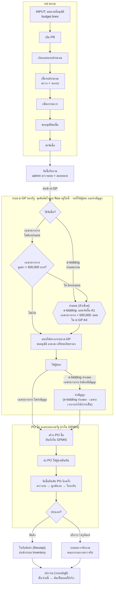

### 3.2 Workflow วิธีเฉพาะเจาะจง

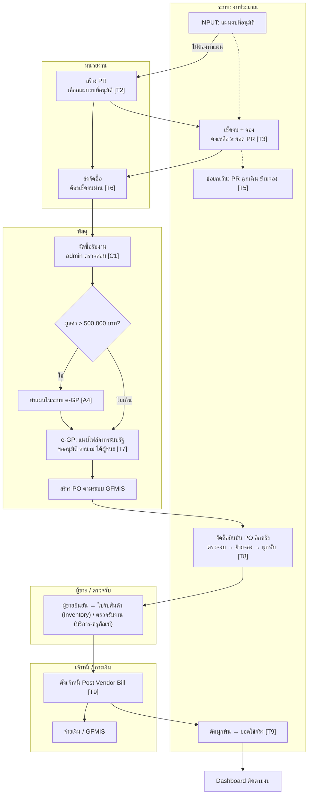

### 3.3 Workflow วิธี e-bidding

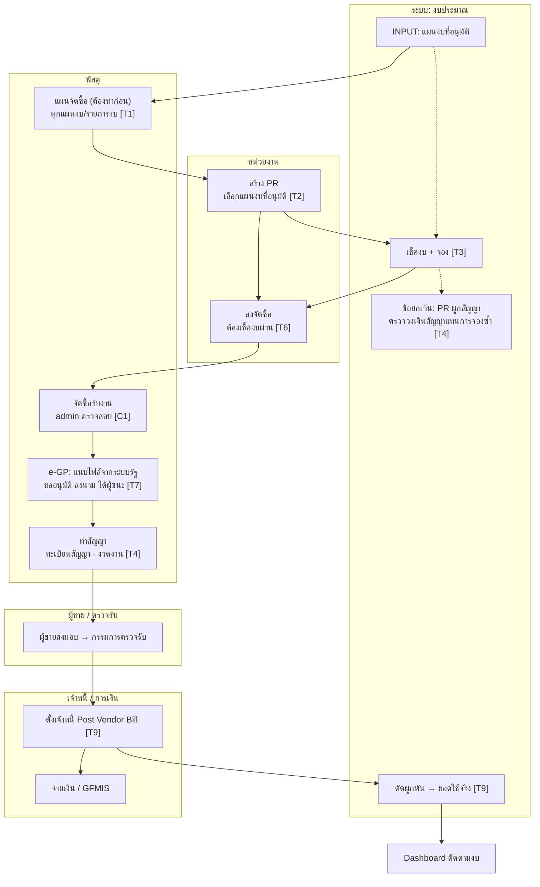

### 3.4 Data Flow ระหว่างงบประมาณ และจัดซื้อจัดจ้าง

วิธีเฉพาะเจาะจง:

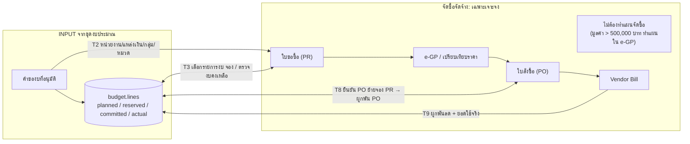

วิธี e-bidding:

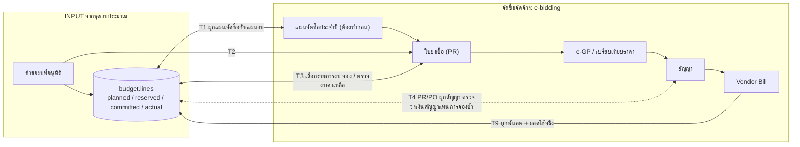

### 3.5 จุดเชื่อมกับงบประมาณ (T1–T10)

| รหัส | วิธีจัดซื้อ | จุดเชื่อม | จาก → ไป | Input | Output / ผลต่องบ | ทริกเกอร์ | Field / Method |
|---|---|---|---|---|---|---|---|
| T1 | e-bidding | **แผนงบประมาณ → แผนจัดซื้อประจำปี** | งบประมาณ → จัดซื้อ (แผนประจำปี) | • แผนงบประมาณประจำปี (budget.budget) • รายการงบประมาณ (budget.lines) | • แผนจัดซื้อ ผูกกับแผนงบประมาณประจำปี • รายการแผน ผูกกับรายการงบ (budget line) | พัสดุจัดทำแผนจัดซื้อประจำปี | `procurement.annual.plan.budget_id · plan line.budget_line_id (vpk_procurement_auto_pr)` |
| T2 | ทั้งสองวิธี | **คำของบที่อนุมัติ → ใบขอซื้อ (PR)** | งบประมาณ → จัดซื้อ (PR) | • คำของบสถานะ Approved (budget_plan_request_id) | • PR ได้ หน่วยงาน, แหล่งเงิน, กลุ่มงบ, หมวดงบ อัตโนมัติ • ปุ่มเลือกรายการแสดงเฉพาะสินค้าในแผนงบนี้ | หน่วยงานสร้าง PR แล้วเลือกแผนงบที่อนุมัติ | `purchase.request.budget_plan_request_id / budget_analytic_account_id / budget_fund_source_id / budget_group_id / budget_post_id` |
| T3 | ทั้งสองวิธี | **PR → รายการงบ: ตรวจและจองงบ** | จัดซื้อ (PR) → งบประมาณ | • บรรทัด PR (ยอดประเมิน estimated cost) • budget_line_id ที่เลือก | • ผ่าน: budget_check_state = enough + จองงบ (budget_reservation_active) • ไม่ผ่าน: บล็อกพร้อมข้อความงบไม่พอ | ปุ่มเช็คงบ / ส่งจัดซื้อ / ส่งอนุมัติ PR | `_prepare_budget_check · _activate_budget_reservation (vpk_budget)` |
| T4 | ทั้งสองวิธี | **PR ผูกสัญญา: ข้ามการจองงบ** | สัญญา → จัดซื้อ (PR) | • PR ที่ผูกสัญญา (contract_id) | • ตรวจวงเงินคงเหลือของสัญญาแทนการจองงบ (Hard Block) • budget_check_state = enough | เช็คงบ / ส่งอนุมัติ PR ที่มีสัญญา | `purchase.request._has_contract_bypass_budget (vpk_purchase_contract)` |
| T5 | ทั้งสองวิธี | **PR ฉุกเฉิน: เส้นทางตรวจงบเร่งด่วน** | จัดซื้อ (PR ฉุกเฉิน) → งบประมาณ | • PR urgency = emergency (ไม่มีสัญญา) • การตั้งค่า emergency_budget_bypass = เปิด | • ผ่านการตรวจงบแบบเร่งด่วน ไม่จองงบทันที • ต้องระบุเหตุผลและวันที่ต้องการของ | ส่ง PR ฉุกเฉิน (เมื่อเปิดตั้งค่า) | `_has_emergency_bypass_budget (vpk_purchase_request_urgent)` |
| T6 | ทั้งสองวิธี | **PR → พัสดุ: ประตูส่งงาน** | จัดซื้อ (หน่วยงาน) → จัดซื้อ (พัสดุ) | • PR สถานะร่าง + รายการที่ไม่ถูกยกเลิก • ผลเช็คงบ (budget_check_state) | • ส่งจัดซื้อได้เมื่อเช็คงบผ่านเท่านั้น (และจองงบแล้ว) • สถานะ = ส่งจัดซื้อแล้ว, แจ้งเจ้าหน้าที่พัสดุ | ปุ่ม 'ส่งจัดซื้อ' บน PR | `action_send_to_procurement (vpk_tier_validation)` |
| T7 | ทั้งสองวิธี | **PR → โครงการ e-GP / เปรียบเทียบราคา** | จัดซื้อ (PR) → จัดซื้อ (e-GP) | • บรรทัด PR (estimated_cost, budget_unit_price) | • วงเงินงบ (budget_amount) และราคาต่อหน่วยบนบรรทัดโครงการ/ผู้เสนอราคา • ใช้เทียบราคาที่เสนอกับวงเงิน | พัสดุส่ง PR เข้ากระบวนการ e-GP | `egp bid line._get_source_budget (vpk_purchase_agreement_egp)` |
| T8 | ทั้งสองวิธี | **PO ยืนยัน: ตรวจงบ → ผูกพันงบ** | จัดซื้อ (PO) → งบประมาณ | • PO + บรรทัดที่ผูก PR / รายการงบ • ยอดจอง PR ที่เชื่อมกัน | • งบไม่พอ → ไม่ให้ยืนยัน PO • ย้ายยอดจอง PR → ผูกพัน PO (po_committed_amount) • PO ยกเลิก → คืนจองให้ PR · PO ผูกสัญญา → ปลด PR เป็น done | ผู้ขายยืนยัน PO (button_confirm) | `purchase.order.button_confirm · _check_budget_before_po_confirm · _transfer_pr_reservation_to_po_commitment` |
| T9 | ทั้งสองวิธี | **PO → ใบเรียกเก็บ: ตัดเป็นยอดใช้จริง** | เจ้าหนี้ → งบประมาณ | • Vendor Bill ผูกบรรทัด PO • หน่วยงาน / แหล่งเงินจาก PR (ส่งต่อตอนสร้าง Bill) | • Post: ผูกพัน PO ลด + analytic line → ยอดใช้จริง (practical) • ยกเลิก/ตั้งร่าง Bill → คืนยอดผูกพัน | สร้าง / ยืนยัน / ยกเลิก Vendor Bill | `PO._prepare_invoice · account.move.action_post · _vpk_budget_touch_purchase_lines` |
| T10 | ทั้งสองวิธี | **จัดซื้อ → ทะเบียนสินทรัพย์** | จัดซื้อ / เจ้าหนี้ → ทรัพย์สิน | • บัตรสินทรัพย์ของครุภัณฑ์ที่ซื้อ | • ระบุแผนงบประมาณ (budget_id) และแหล่งเงินที่ซื้อ • ติดตามที่มาจาก PO, ใบแจ้งหนี้, GFMIS, งบ | ลงทะเบียน/แก้ไขบัตรสินทรัพย์ | `account.asset.budget_id / fund_source_id (vpk_asset_registry)` |

### 3.6 Input / Process / Output ของแต่ละ function

#### A. แผนจัดซื้อ และข้อมูลนำเข้าจากงบประมาณ

_แผนจัดซื้อประจำปีผูกกับแผนงบที่อนุมัติ และสร้าง PR อัตโนมัติ_

| รหัส | ฟังก์ชัน | ผู้ใช้ | วิธีจัดซื้อ | Input | Process | Output | เมนู | Model / Method |
|---|---|---|---|---|---|---|---|---|
| A1 | **แผนจัดซื้อประจำปีงบประมาณ** | พัสดุ | e-bidding | • ปีงบประมาณ (เริ่ม - สิ้นสุด) • แผนงบประมาณประจำปี (budget_id) • รายการแผน: สินค้า จำนวน ราคา • รายการงบ (budget_line_id) | › บันทึกรายการแผน แล้วอนุมัติแผน › คำนวณยอดที่ PR ใช้ไปเทียบแผน | • แผนจัดซื้อสถานะอนุมัติ ผูกแผนงบ/รายการงบ • ยอดใช้แล้ว / คงเหลือของแต่ละรายการแผน • ฐานสำหรับสร้าง PR | แผนจัดซื้อจัดจ้าง (ภายใน) > แผนประจำปีงบประมาณ | `procurement.annual.plan(.line) · action_approve · _recompute_consumed` |
| A2 | **คำขอเพิ่มแผน** | หน่วยงาน / พัสดุ | e-bidding | • แผนประจำปีที่อนุมัติแล้ว • รายการที่ขอเพิ่ม (สินค้า จำนวน ยอด) • เหตุผลการขอเพิ่มแผน | › ส่งขออนุมัติ (ต้องมี ≥ 1 รายการ) › อนุมัติ → เพิ่มรายการเข้าแผนหลัก | • รายการใหม่ในแผนประจำปี • สถานะ: ส่งแล้ว / อนุมัติ / ตีกลับ • พร้อม Gen Auto PR ต่อได้ | แผนจัดซื้อจัดจ้าง (ภายใน) > คำขอเพิ่มแผน | `procurement.plan.amendment · action_submit / action_approve` |
| A3 | **Auto Gen PR** | ระบบ (Cron) / พัสดุ | e-bidding | • แผนที่อนุมัติ + เปิด Gen Auto • จุดสั่งซื้อ (reorder) ของสินค้า • สัญญาใกล้หมดอายุ (ค่าเริ่มต้น 60 วัน) | › Cron สร้าง PR ตามแผน › ผูกบรรทัด PR กับรายการแผน | • PR ร่างที่สร้างอัตโนมัติ • ยอดใช้แล้วของรายการแผนเพิ่มขึ้น | แผนประจำปี > ปุ่ม Gen Auto | `_cron_auto_generate_prs · action_run_auto_gen_now` |
| A4 | **แผนในระบบ e-GP (มูลค่า > 500,000 บาท)** | พัสดุ | เฉพาะเจาะจง | • วิธีเฉพาะเจาะจง • มูลค่าโครงการ (ยอดประเมิน PR) > 500,000 บาท • รายละเอียดโครงการ + ปีงบประมาณ | › บันทึกแผนในระบบ e-GP ก่อนจัดซื้อ › ไม่เกิน 500,000 บาท ข้ามขั้นนี้ได้ | • แผนในระบบ e-GP (เลขแผน/เลขโครงการ) • ดำเนินการต่อ: แนบไฟล์จาก e-GP จนได้ผู้ชนะ แล้วสร้าง PO | ระบบ e-GP (ภายนอก ERP) > แผนการจัดซื้อจัดจ้าง | `ขั้นตอนในระบบ e-GP (ERP ยังไม่บังคับ) · purchase.request.estimated_cost` |

#### B. หน่วยงาน: ใบขอซื้อ (PR)

_ใช้แผนงบที่อนุมัติ ทำใบขอซื้อ ตรวจ/จองงบ ลงนาม และส่งจัดซื้อ_

| รหัส | ฟังก์ชัน | ผู้ใช้ | วิธีจัดซื้อ | Input | Process | Output | เมนู | Model / Method |
|---|---|---|---|---|---|---|---|---|
| B1 | **สร้างใบขอซื้อ (PR) จากแผนงบที่อนุมัติ** | หน่วยงาน | ทั้งสองวิธี | • แผนงบที่อนุมัติ (budget_plan_request_id) • ประเภทพัสดุ ซื้อ/จ้าง/เช่า • วิธีจัดซื้อ: เฉพาะเจาะจง (ไม่ต้องมีแผน) / e-bidding (ต้องมีแผนก่อน) • คลังรับสินค้า | › ดึงหน่วยงาน แหล่งเงิน กลุ่มงบ หมวดงบจากแผนงบ › ออกเลข PR อัตโนมัติ (PR + ปี พ.ศ. + เดือน + running) | • PR สถานะร่าง เลขที่ PRyymm### • ปุ่มเลือกรายการแสดงเฉพาะสินค้าในแผนงบ | ระบบจัดซื้อจัดจ้าง > ข้อมูลใบขอซื้อ > ใบขอซื้อ | `purchase.request · budget_plan_request_id (vpk_budget)` |
| B2 | **รายการสินค้า และรายชื่อคณะกรรมการ** | หน่วยงาน | ทั้งสองวิธี | • สินค้า จำนวน หน่วยวัด วันที่ต้องการ • งบประมาณรายบรรทัด, ชื่อซื้อใน e-GP • ไฟล์คุณลักษณะ (PDF) • รายชื่อกรรมการ (ประธาน 1 คน) | › เติมชื่อ/หน่วย/ชื่อ e-GP จากสินค้า › ตรวจประธานคณะกรรมการมีเพียง 1 คน | • บรรทัด PR + ยอดงบประมาณที่ขอรวม • รายชื่อคณะกรรมการ (ใช้ต่อตอนตรวจรับ) | PR > แท็บสินค้า / แท็บรายชื่อคณะกรรมการ | `purchase.request.line · committee lines` |
| B3 | **ตรวจสอบงบประมาณ + จองงบ** | หน่วยงาน / ระบบ | ทั้งสองวิธี | • บรรทัด PR (ยอดประเมิน) • รายการงบ (budget.lines) ของแผนงบ • ยอดจอง PR อื่น + ผูกพัน PO + ใช้จริง | › คงเหลือ = แผน − ใช้จริง − จอง − ผูกพัน › ผูกสัญญา → ตรวจวงเงินสัญญาแทน › ฉุกเฉิน (ตั้งค่า) → ข้ามจอง | • ผ่าน: สถานะเช็คงบ + จองงบ • ไม่ผ่าน: บล็อกพร้อมข้อความงบไม่พอ • แท็บแสดงงบที่จอง / คงเหลือหลังหักใบนี้ | ปุ่มเช็คงบประมาณที่หัวเอกสาร + แท็บตรวจสอบงบประมาณ | `_prepare_budget_check · _activate_budget_reservation · contract/urgent bypass` |
| B4 | **บันทึกอนุมัติขอซื้อ + ลงนาม** | หน่วยงาน / ผู้ลงนาม | ทั้งสองวิธี | • PR ที่เช็คงบผ่าน + รายชื่อกรรมการ • Template บันทึกข้อความ • เลขสารบรรณ (ขอจากเอกสาร) | › ออกบันทึกข้อความจากข้อมูล PR › พิมพ์ PDF แล้วส่งลงนามตามลำดับ | • เอกสารลงนามครบ (ลายเซ็นบน PDF) • PR เปลี่ยนเป็นอนุมัติ พร้อมส่งจัดซื้อ | PR > แท็บเอกสารอนุมัติขอซื้อ | `vpk_document_studio_sign · vpk_pr_saraban · vpk_tier_validation` |
| B5 | **ส่งจัดซื้อ** | หน่วยงาน | ทั้งสองวิธี | • PR สถานะร่าง + มีรายการสินค้า • ผลเช็คงบ = ผ่าน | › ตรวจเช็คงบผ่าน / จองงบ › แจ้งเจ้าหน้าที่พัสดุ | • สถานะ = ส่งจัดซื้อแล้ว • PR เข้า Dashboard พัสดุรับงาน • หน่วยงานแก้ไขไม่ได้ | ปุ่ม 'ส่งจัดซื้อ' ที่หัวเอกสาร | `action_send_to_procurement (vpk_tier_validation)` |
| B6 | **ขอซื้อฉุกเฉิน / เร่งด่วน** | หน่วยงาน | ทั้งสองวิธี | • ระดับ urgent / emergency • เหตุผล + วันที่ต้องการของ | › บังคับกรอกเหตุผล/วันที่ › ใช้เส้นทางอนุมัติเร่งด่วน | • PR ฉุกเฉิน/เร่งด่วน เข้าสู่กระบวนการ • ฉุกเฉิน + เปิดตั้งค่า: ตรวจงบเร่งด่วน (ไม่จองทันที) | จัดการสั่งซื้อ > ขอซื้อฉุกเฉิน / เร่งด่วน | `vpk_purchase_request_urgent · _has_emergency_bypass_budget` |
| B7 | **แจ้งเตือนเมื่อ PR ไม่ผ่านอนุมัติ** | ระบบ | ทั้งสองวิธี | • PR ถูกตีกลับ / ไม่อนุมัติ | › แจ้งผู้ขอและกลุ่มงาน › คืนยอดจองงบของ PR | • การแจ้งเตือนถึงผู้ขอ/กลุ่มงาน • งบที่จองกลับคืนรายการงบ | อัตโนมัติเมื่อ PR ถูกปฏิเสธ | `vpk_purchase_request_reject_notify · _release_budget_reservation` |

#### C. พัสดุ: รับงาน เอกสารราชการ และ e-GP

_จัดซื้อรับงาน (admin ตรวจสอบ) ออกเอกสาร แนบไฟล์จากระบบ e-GP ของรัฐ ขออนุมัติลงนาม จนได้ผู้ชนะ_

| รหัส | ฟังก์ชัน | ผู้ใช้ | วิธีจัดซื้อ | Input | Process | Output | เมนู | Model / Method |
|---|---|---|---|---|---|---|---|---|
| C1 | **กล่องรวมงานพัสดุ และมอบหมายงาน** | หัวหน้าพัสดุ / admin → เจ้าหน้าที่พัสดุ | ทั้งสองวิธี | • PR สถานะส่งจัดซื้อแล้ว จากหน่วยงาน | › ใบรวมที่กล่องกลาง › admin / หัวหน้าตรวจสอบใบขอซื้อ › มอบหมายหรือส่งต่องานให้เจ้าหน้าที่ที่เกี่ยวข้อง › เจ้าหน้าที่เปิดทำรายการจากงานของฉัน | • PR ถูกมอบหมายให้เจ้าหน้าที่พัสดุ • เห็นแท็บเอกสารราชการที่เกี่ยวข้อง | ข้อมูลใบขอซื้อ > กล่องรวมงานพัสดุ | `vpk_procurement_inbox (กล่องรวมงานพัสดุ · action_assign_procurement)` |
| C2 | **ออกเอกสารราชการที่เกี่ยวข้อง** | พัสดุ / ผู้ลงนาม | ทั้งสองวิธี | • PR + กรรมการจาก PR • Template ที่ผูกไว้ • วงเงิน > 100,000 → แบบแสดงความบริสุทธิ์ใจ | › สร้างเอกสาร: คำสั่งแต่งตั้งกรรมการตรวจรับ, รายงานขออนุมัติจัดซื้อ › ขอเลขสารบรรณ → PDF → ส่งลงนาม | • เอกสารลงนามครบทุกฉบับ • เงื่อนไขพร้อมไปขั้น e-GP | PR > แท็บเอกสารราชการที่เกี่ยวข้อง | `vpk_official_document · vpk_committee_appointment · vpk_pr_saraban` |
| C3 | **เปิดเอกสาร e-GP จาก PR (ที่แนบไฟล์)** | พัสดุ | ทั้งสองวิธี | • PR อนุมัติแล้ว + เอกสารลงนามครบ • ประเภทการจัดซื้อ = ผ่านพัสดุ | › สร้างเอกสารกระบวนการ e-GP จาก PR เป็นที่แนบไฟล์จากระบบ e-GP ของรัฐ › คัดลอกรายการสินค้า + วงเงินงบจาก PR | • เอกสารกระบวนการ e-GP (ปุ่มสถิติบน PR) • วงเงินงบ/ราคาต่อหน่วยบนบรรทัด e-GP | PR > ปุ่ม 'ส่งรายการเข้าระบบ e-GP' | `purchase.requisition (egp_procurement) · _get_source_budget` |
| C4 | **แนบไฟล์ e-GP รัฐ + เปรียบเทียบราคา** | พัสดุ | ทั้งสองวิธี | • เลขที่ + ชื่อโครงการ e-GP • ไฟล์จาก e-GP (ประกาศร่าง ฯลฯ) • ข้อมูลผู้เสนอราคา | › แนบไฟล์ที่ได้จากระบบ e-GP ของรัฐ ตามขั้นตอน (ขออนุมัติ ลงนาม) › เทียบราคากับวงเงินงบ › คัดเลือกจนได้ผู้ชนะ | • ตารางเปรียบเทียบราคา • ผู้ชนะที่เลือก • เอกสาร e-GP แนบครบ | กระบวนการ eGP > เปรียบเทียบราคา | `purchase.requisition.egp.bid(.line) · egp.document` |
| C5 | **รายงานผลพิจารณา และประกาศผู้ชนะ** | พัสดุ / ผู้ลงนาม | ทั้งสองวิธี | • ผู้ชนะที่เลือก + วงเงินที่ขออนุมัติ • Template รายงานผล / ประกาศ | › จัดทำรายงานผล → ส่งลงนาม › เมื่อลงนาม → ประกาศผู้ชนะ → ส่งลงนาม | • รายงานผลการพิจารณา + ประกาศผู้ชนะ (PDF) • ปุ่ม 'สร้าง PO' แสดงเมื่อเงื่อนไขครบ | แท็บเปรียบเทียบราคา > จัดทำรายงานผลและขออนุมัติ / ประกาศผู้ชนะ | `award_approval_docx · winner_announcement_docx` |

#### D. ใบสั่งซื้อ (PO) และสัญญา

_สร้าง/ส่ง PO ให้ผู้ขายยืนยัน (ผูกพันงบ) ทะเบียนสัญญา หลักประกัน ค่าปรับ_

| รหัส | ฟังก์ชัน | ผู้ใช้ | วิธีจัดซื้อ | Input | Process | Output | เมนู | Model / Method |
|---|---|---|---|---|---|---|---|---|
| D1 | **สร้างใบสั่งซื้อ (PO) ตามระบบ GFMIS** | พัสดุ | ทั้งสองวิธี | • เอกสาร e-GP ที่มีผู้ชนะ + รายงานผลอนุมัติ • เลขอ้างอิงใบเสนอราคา e-GP (ถ้ามี) | › ผู้ขาย = ผู้ชนะ (เปลี่ยนไม่ได้) › ดึงรายการและราคาจากข้อเสนอ / สัญญา › PO ต้องสอดคล้องระบบงานรัฐ: บันทึกใน GFMIS (ภายนอก ERP) | • PO สถานะร่าง ผูก PR / เอกสาร e-GP • ไฟล์ใบสั่งซื้อ/สั่งจ้างตามแบบ VPK | เอกสาร e-GP > ปุ่ม 'สร้าง PO' | `purchase.order · vpk_purchase_order_form` |
| D2 | **ส่ง PO ให้ผู้ขายยืนยัน** | พัสดุ / ผู้ขาย | ทั้งสองวิธี | • PO ร่าง + ไฟล์ PDF • บัญชี Portal ของผู้ขาย | › ส่งเข้าแอป: ยังไม่ส่ง → รอผู้ขายยืนยัน › ผู้ขายเปิด PDF ลงนาม และกดบันทึก | • ผู้ขายยืนยันแล้ว (signed_by / signed_on) • ส่งกลับให้จัดซื้อยืนยัน PO อีกครั้ง (ตรวจงบ + ผูกพัน) | PO > ส่งเข้าแอปผู้ขาย / แอประบบบริการผู้จำหน่าย | `action_portal_vendor_confirm (vpk_purchase_portal_egp)` |
| D3 | **จัดซื้อยืนยัน PO อีกครั้ง → ผูกพันงบ** | ระบบ / พัสดุ | ทั้งสองวิธี | • PO + บรรทัดผูก PR / รายการงบ • ยอดจอง PR ที่เชื่อมกัน | › ตรวจงบอีกครั้ง › ย้ายยอดจอง PR → ผูกพัน PO › ปิดเอกสาร e-GP เมื่อไม่มี PO ค้าง | • PO สถานะคำสั่งซื้อ + ใบรอรับสินค้า (สินค้า → ส่งไประบบ Inventory) • บริการ / ครุภัณฑ์ → เข้าระบบตรวจรับงาน • ยอดผูกพัน PO เพิ่ม / ยอดจอง PR ลด • งบไม่พอ → ไม่ให้ยืนยัน | จัดซื้อยืนยัน PO หลังผู้ขายยืนยัน (button_confirm) | `button_confirm · _check_budget_before_po_confirm · _transfer_pr_reservation_to_po_commitment (ERP ปัจจุบันยืนยันอัตโนมัติเมื่อผู้ขายยืนยัน)` |
| D4 | **ทะเบียนสัญญา** | พัสดุ | ทั้งสองวิธี | • เอกสาร e-GP ที่เลือกผู้ชนะแล้ว • ประเภทสัญญา: สัญญาซื้อขาย / สัญญาจะซื้อจะจ้างไม่จำกัดจำนวน • งวดงาน, เอกสารสัญญา, เงื่อนไข, หลักประกัน | › สร้างสัญญา (CTR/ปี/เลขวิ่ง) ดึงคู่ค้า/มูลค่า/เลขโครงการ › ตรวจผลรวมงวด = มูลค่าสัญญา แล้วยืนยัน | • สัญญามีผลบังคับใช้ • PR/PO ผูกสัญญา → ตรวจวงเงินคงเหลือสัญญา • รายงานทะเบียนคุมสัญญา | จัดการสั่งซื้อ > ทะเบียนสัญญา / ปุ่ม 'เปิดทะเบียนสัญญา' บน e-GP | `purchase.contract · action_confirm · installments` |
| D5 | **หลักประกัน และค่าปรับ** | พัสดุ | ทั้งสองวิธี | • สัญญา / PO • หนังสือค้ำประกัน (เลขที่ มูลค่า วันเริ่ม-สิ้นสุด) • กรณีส่งมอบล่าช้า | › หลักประกัน: ใช้งาน → ภาระผูกพันเสร็จ → คืน / เรียกร้อง › ค่าปรับ: ยืนยัน → หักแล้ว / ยกเว้น | • ทะเบียนหลักประกัน + สถานะ • ทะเบียนค่าปรับต่อ PO • รายการหลักประกันบนสัญญา | จัดการสั่งซื้อ > ทะเบียนหลักประกัน / ทะเบียนค่าปรับ | `procurement.guarantee · procurement.purchase.penalty` |

#### E. ตรวจรับ เจ้าหนี้ และติดตามการใช้งบ

_ตรวจรับ รับเข้าคลัง ตั้งเจ้าหนี้ตัดยอดใช้จริง ติดตามและรายงาน_

| รหัส | ฟังก์ชัน | ผู้ใช้ | วิธีจัดซื้อ | Input | Process | Output | เมนู | Model / Method |
|---|---|---|---|---|---|---|---|---|
| E1 | **ตรวจรับมอบงาน** | คณะกรรมการตรวจรับ | ทั้งสองวิธี | • PO ที่จัดซื้อยืนยันแล้ว (บริการ / ครุภัณฑ์) · ผูกสัญญา (ถ้ามี) • จำนวน/ราคาจาก PO (แก้เฉพาะที่รับจริง) • ผลตรวจรับ + วันตรวจรับ | › สร้างใบตรวจรับ (Draft) › ผลไม่ผ่านจะตรวจรับไม่ได้ › กดตรวจรับ เลือกวันที่ | • ใบตรวจรับสถานะ Accepted • อีเมลแจ้งผู้ขอซื้อ (เข้าคิวส่ง) | จัดซื้อ > ตรวจรับมอบงาน > บันทึกรับมอบงาน | `work.acceptance · button_accept (vpk_work_acceptance)` |
| E2 | **รับสินค้าเข้าคลัง (ระบบ Inventory)** | คลัง | ทั้งสองวิธี | • ใบรอรับสินค้า (สร้างเมื่อจัดซื้อยืนยัน PO) เฉพาะสินค้า • ล็อต / วันหมดอายุ, ผลตรวจคุณภาพ | › รับเต็ม/บางส่วน › ตรวจสอบเข้าคลัง | • สินค้าเข้าคลัง (รับบางส่วนเปิดใบรับที่เหลือ) • ปรับสถานะรับสินค้าบน PO | งานคลัง > ใบรับสินค้า (Receipt) | `stock.picking · purchase_stock` |
| E3 | **ตั้งเจ้าหนี้ → ตัดเป็นยอดใช้จริง** | เจ้าหนี้ / บัญชี | ทั้งสองวิธี | • Vendor Bill ผูกบรรทัด PO • หน่วยงาน / แหล่งเงินจาก PR | › Post bill → qty_invoiced เพิ่ม › คำนวณผูกพัน PO ใหม่ | • ผูกพัน PO ลด + analytic line → ยอดใช้จริง • ยกเลิก/ตั้งร่าง bill → คืนผูกพัน • ส่งต่อการเงิน (GFMIS / จ่ายเงิน) | ใบเรียกเก็บ (Vendor Bill) > ยืนยัน | `account.move.action_post · _vpk_budget_touch_purchase_lines` |
| E4 | **ติดตามการใช้งบ** | งานงบประมาณ / ผู้บริหาร | ทั้งสองวิธี | • budget.lines + ยอดใช้จริงรายเดือน • ยอดจอง PR / ผูกพัน PO • ตัวกรอง ปี / แหล่งเงิน / หน่วยงาน | › รวมยอดจัดสรร ใช้จริง ผูกพัน จอง › เทียบแผนรายเดือนและปีก่อน | • แผน / ใช้จริง / จอง / ผูกพัน / คงเหลือ ต่อรายการงบ • กราฟเบิกจ่ายสะสมเทียบแผน, ตารางตามประเภท/กลุ่มงาน • รายการเร่งดำเนินการ | งบประมาณ > รายการงบประมาณ / Dashboard ติดตามงบประมาณประจำปี | `budget.lines._compute_pr_budget_amounts · get_annual_expenditure_overview` |
| E5 | **ติดตามและรายงานจัดซื้อ** | พัสดุ / ผู้บริหาร | ทั้งสองวิธี | • PR / PO / สัญญา / e-GP / GFMIS • ช่วงเวลา วัน-สัปดาห์-เดือน-ปี | › ติดตามสถานะ PR (ออก/ยังไม่ออก PO) › รวบรวมทะเบียนคุมและรายงาน | • Dashboard ติดตามการจัดซื้อ + Export รายงาน • ทะเบียนคุมสัญญา / e-GP / GFMIS • สินค้าค้างรับ, PO ถึงกำหนดส่ง | จัดการสั่งซื้อ > ติดตาม / รายงานขอซื้อ-สั่งซื้อ | `vpk_purchase_request_tracking · vpk_procurement_auto_pr reports` |

## 4. Workflow ตามประเภทสัญญา (e-bidding ทำเสมอ · เฉพาะเจาะจงทำได้ถ้าจำเป็น)

ประเภทสัญญาเป็นข้อมูลหลักที่เพิ่มได้ในระบบ (ตารางประเภทสัญญา) ระบบตรวจวงเงินสัญญาเป็น **มูลค่า**
(Hard Block ที่ PR และตอนยืนยัน PO) ไม่ได้ตรวจจำนวนชิ้น ความต่างของสองประเภทเกิดจากการมี/ไม่มีงวดงาน
และความหมายของมูลค่ารวมสัญญา

### 4.1 เปรียบเทียบ

| หัวข้อ | สัญญาซื้อขาย | สัญญาจะซื้อจะจ้างไม่จำกัดจำนวน |
|---|---|---|
| **ลักษณะสัญญา** | กำหนดรายการ จำนวน และมูลค่าชัดเจน ส่งมอบครั้งเดียวหรือแบ่งเป็นงวด | สัญญากรอบ กำหนดราคาต่อหน่วยและระยะเวลา เรียกใช้ตามความต้องการ ไม่ระบุจำนวนที่แน่นอน |
| **มูลค่ารวมสัญญา** | = ยอดเสนอราคาของผู้ชนะ (ค่างานจริง) | = วงเงินเพดานของสัญญา (ใช้ได้ไม่เกินวงเงิน) |
| **งวดงาน** | แบ่งงวดได้ (เท่ากัน/กำหนดเอง) ผลรวมงวด = มูลค่าสัญญา | ไม่สร้างงวดงาน |
| **การเปิด PR** | เปิด PR ต่องวด ระบบดึงงวดที่ยังไม่ถูกใช้ถัดไปให้ | เปิด PR ทุกครั้งที่ต้องการ เพิ่มรายการเอง (ระบบแจ้งว่าสัญญาไม่มีงวดงาน) |
| **จำนวนรอบ PR / PO** | ตามจำนวนงวดที่กำหนด | ไม่จำกัดจำนวนรอบ จนวงเงินหมดหรือสัญญาหมดอายุ |
| **การตรวจวงเงินสัญญา** | Hard Block ที่ PR และตอนยืนยัน PO (คงเหลือ = มูลค่าสัญญา − PO ยืนยัน − PR ที่จอง) | เหมือนกัน: Hard Block ที่ PR และตอนยืนยัน PO |
| **การปิดสัญญา** | ครบทุกงวด / ครบอายุสัญญา แล้วกดปิดสัญญา | วงเงินหมด / หมดอายุสัญญา แล้วกดปิดสัญญา |
| **การตั้งค่าในระบบ** | เลือกประเภทสัญญา = สัญญาซื้อขาย (เพิ่มในตารางประเภทสัญญา) | เลือกประเภทสัญญา = สัญญาจะซื้อจะจ้างไม่จำกัดจำนวน + ไม่สร้างงวด + ตั้งมูลค่ารวมเป็นวงเงินเพดาน |

### 4.2 สัญญาซื้อขาย

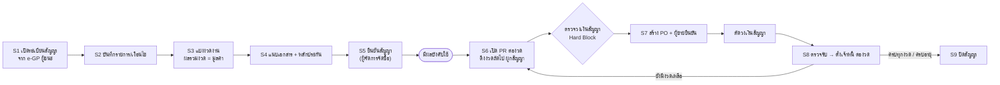

ขั้นตอนละเอียด:

| ขั้น | ขั้นตอน | ผู้ทำ | Input | Process | Output | Field / Method |
|---|---|---|---|---|---|---|
| S1 | **เปิดทะเบียนสัญญาจาก e-GP** | พัสดุ | • เอกสาร e-GP ที่เลือกผู้ชนะแล้ว • ประเภทสัญญา = สัญญาซื้อขาย | › สร้างสัญญาแบบร่าง รหัส CTR/ปี/เลขวิ่ง › คู่ค้า = ผู้ชนะ · มูลค่า = ยอดเสนอราคา | • สัญญาสถานะแบบร่าง อ้างอิงเอกสาร e-GP | `purchase.contract · requisition_id` |
| S2 | **บันทึกรายการและเงื่อนไข** | พัสดุ | • รายการสินค้า จำนวน ราคาต่อหน่วย • วันเริ่ม · ส่งมอบภายใน (วัน) · รับประกัน • จ่ายครั้งเดียว / ตามงวด · จ่ายล่วงหน้า | › คำนวณวันส่งมอบและวันสิ้นสุด | • หัวสัญญาและรายการที่ตกลงซื้อขายครบ | `purchase.contract.line · payment_type` |
| S3 | **แบ่งงวดงาน (ถ้าจ่ายตามงวด)** | พัสดุ | • จำนวนงวด + วิธีแบ่ง (เท่ากัน/กำหนดเอง) • ชื่องวด มูลค่า กำหนดจ่าย | › สร้างรายการงวด › ผลรวมงวดต้องเท่ากับมูลค่าสัญญา | • รายการงวดงาน (จ่ายครั้งเดียวไม่ต้องแบ่ง) | `purchase.contract.installment · wizard แบ่งงวด` |
| S4 | **แนบเอกสารและหลักประกัน** | พัสดุ | • สัญญาที่ลงนามแล้ว · TOR • หนังสือค้ำประกัน (ถ้ามี) | › แนบเอกสารสัญญา › บันทึกหลักประกันของสัญญา | • เอกสารสัญญาและหลักประกันบนสัญญา | `contract_attachment_ids · procurement.guarantee` |
| S5 | **ยืนยันสัญญา** | ผู้จัดการจัดซื้อ | • สัญญาแบบร่างที่ครบข้อมูล (คู่ค้า มูลค่า) | › ตรวจผลรวมงวด = มูลค่าสัญญา › บันทึกวันที่ยืนยัน คำนวณวันสิ้นสุด | • สถานะมีผลบังคับใช้ (แก้หัวสัญญาไม่ได้) | `action_confirm` |
| S6 | **เปิด PR ผูกสัญญา (ต่องวด)** | หน่วยงาน | • สัญญาที่มีผลบังคับใช้ • งวดที่ยังไม่ถูกใช้ | › เลือกสัญญาบน PR ระบบดึงงวดถัดไป (สินค้า มูลค่างวด) › ตรวจวงเงินสัญญา ไม่จองงบซ้ำ | • PR บรรทัดงวด ผูกสัญญา • ยอดจองวงเงินสัญญาเพิ่ม | `purchase.request.contract_id · _check_contract_balance` |
| S7 | **สร้าง PO และผู้ขายยืนยัน** | พัสดุ / ผู้ขาย | • PR ผูกสัญญาที่อนุมัติแล้ว | › สร้าง PO ผูกสัญญา › ยืนยัน PO: เกินวงเงินคงเหลือจะถูกบล็อก | • ยอดตัดจาก PO เพิ่ม • มูลค่าคงเหลือของสัญญาลด | `purchase.order.contract_id · _check_amount_available` |
| S8 | **ตรวจรับ → ตั้งเจ้าหนี้ ต่องวด** | กรรมการตรวจรับ / เจ้าหนี้ | • PO ของงวดนั้น • ผลตรวจรับ / ค่าปรับถ้าส่งล่าช้า | › ตรวจรับ (ผ่านเท่านั้น) › Post Vendor Bill | • ยอดใช้จริงของงวด • ถ้ายังมีงวดเหลือ วนกลับขั้น S6 | `work.acceptance · account.move.contract_id` |
| S9 | **ปิดสัญญา** | พัสดุ | • ครบทุกงวด หรือครบอายุสัญญา | › กดปิดสัญญา › คืนหลักประกัน (ถ้ามี) | • สถานะปิดสัญญา | `action_done` |

### 4.3 สัญญาจะซื้อจะจ้างไม่จำกัดจำนวน

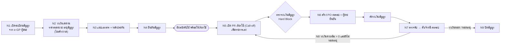

ขั้นตอนละเอียด:

| ขั้น | ขั้นตอน | ผู้ทำ | Input | Process | Output | Field / Method |
|---|---|---|---|---|---|---|
| N1 | **เปิดทะเบียนสัญญาจาก e-GP** | พัสดุ | • เอกสาร e-GP ที่เลือกผู้ชนะแล้ว • ประเภทสัญญา = สัญญาจะซื้อจะจ้างไม่จำกัดจำนวน | › สร้างสัญญาแบบร่าง รหัส CTR/ปี/เลขวิ่ง › คู่ค้า = ผู้ชนะ | • สัญญากรอบสถานะแบบร่าง อ้างอิงเอกสาร e-GP | `purchase.contract · contract_type_id` |
| N2 | **กำหนดวงเงินเพดาน ราคาต่อหน่วย อายุสัญญา** | พัสดุ | • มูลค่ารวมสัญญา = วงเงินเพดาน • รายการสินค้า + ราคาต่อหน่วย • วันเริ่ม - วันสิ้นสุด · รับประกัน | › ไม่สร้างงวดงาน (เรียกใช้ตามความต้องการ) | • สัญญากรอบที่มีเพดานวงเงินและอายุ | `amount_total · date_start / date_end` |
| N3 | **แนบเอกสารและหลักประกัน** | พัสดุ | • สัญญาที่ลงนามแล้ว · TOR • หนังสือค้ำประกัน (ถ้ามี) | › แนบเอกสารสัญญา › บันทึกหลักประกันของสัญญา | • เอกสารสัญญาและหลักประกันบนสัญญา | `contract_attachment_ids · procurement.guarantee` |
| N4 | **ยืนยันสัญญา** | ผู้จัดการจัดซื้อ | • สัญญากรอบที่ครบข้อมูล (คู่ค้า วงเงิน) | › ไม่มีงวดจึงไม่ตรวจผลรวมงวด › บันทึกวันที่ยืนยัน | • สถานะมีผลบังคับใช้ พร้อมให้เรียกใช้ | `action_confirm` |
| N5 | **เปิด PR เรียกใช้ (Call-off)** | หน่วยงาน | • สัญญาที่มีผลบังคับใช้ • ความต้องการรอบนี้ (รายการ จำนวน) | › เลือกสัญญาบน PR ระบบแจ้งยอดคงเหลือและให้เพิ่มรายการเอง › ตรวจวงเงินสัญญา ไม่จองงบซ้ำ | • PR ผูกสัญญา • ยอดจองวงเงินสัญญาเพิ่ม | `purchase.request.contract_id · _check_contract_balance` |
| N6 | **สร้าง PO ต่อรอบ และผู้ขายยืนยัน** | พัสดุ / ผู้ขาย | • PR ผูกสัญญาที่อนุมัติแล้ว | › สร้าง PO ผูกสัญญา › ยืนยัน PO: เกินวงเงินคงเหลือจะถูกบล็อก | • ยอดตัดจาก PO เพิ่ม • วงเงินคงเหลือของสัญญาลด | `purchase.order.contract_id · _check_amount_available` |
| N7 | **ตรวจรับ → ตั้งเจ้าหนี้ ต่อรอบ** | กรรมการตรวจรับ / เจ้าหนี้ | • PO ของรอบนั้น • ผลตรวจรับ / ค่าปรับถ้าส่งล่าช้า | › ตรวจรับ (ผ่านเท่านั้น) › Post Vendor Bill | • ยอดใช้จริงของรอบ • ติดตามคงเหลือสัญญาได้จากรายงานติดตามสัญญา | `work.acceptance · account.move.contract_id` |
| N8 | **เรียกใช้ซ้ำ (วนขั้น N5–N7)** | หน่วยงาน / พัสดุ | • วงเงินคงเหลือ > 0 • สัญญายังไม่หมดอายุ | › เปิด PR รอบใหม่ จนวงเงินหมดหรือหมดอายุ | • จำนวนรอบ PR/PO ไม่จำกัด ตามวงเงิน | `get_remaining_amount` |
| N9 | **ปิดสัญญา** | พัสดุ | • วงเงินหมด หรือหมดอายุสัญญา | › กดปิดสัญญา › คืนหลักประกัน (ถ้ามี) | • สถานะปิดสัญญา | `action_done` |
## 5. ไฟล์ที่เกี่ยวข้อง

| ไฟล์ | หน้าที่ |
|---|---|
| `docs/budget_dataflow_data.py` | ข้อมูล Input/Process/Output ชุดงบประมาณ |
| `docs/procurement_dataflow_data.py` | ข้อมูลชุดจัดซื้อจัดจ้าง จุดเชื่อม T1–T10 และประเภทสัญญา |
| `docs/build_dataflow_md.py` | สร้างไฟล์นี้ |
| `docs/build_budget_dataflow_pptx.py` | สร้าง `Workflow-Dataflow-งบประมาณ.pptx` |
| `docs/build_procurement_dataflow_pptx.py` | สร้าง `Workflow-Dataflow-จัดซื้อจัดจ้าง.pptx` |
| `docs/build_module_function_summary_xlsx.py` | สร้าง `สรุป-Function-ตาม-Module.xlsx` |

> ข้อสังเกต: การติดป้ายวิธีจัดซื้อ (เฉพาะเจาะจง / e-bidding) และความหมายของประเภทสัญญา
> เป็นไปตามที่ผู้ใช้ระบุและพฤติกรรมของโค้ด ควรให้พัสดุยืนยันกับแนวปฏิบัติจริงของโรงพยาบาล
